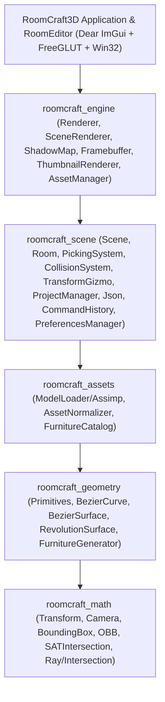
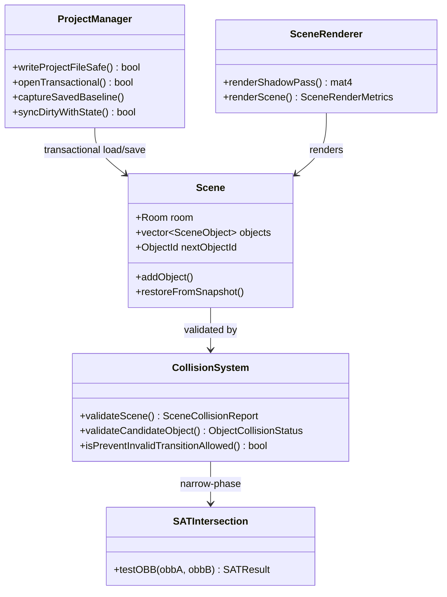
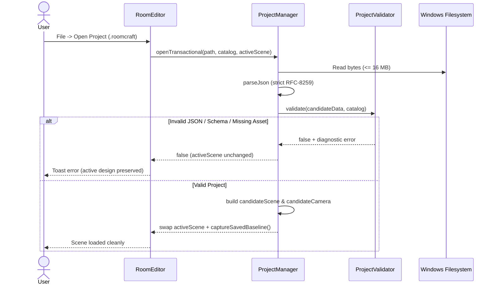

# Tài liệu Hỗ trợ Báo cáo & Bảo vệ Đồ án Môn Đồ họa Máy tính (Academic Delivery Guide)

Tài liệu này tổng hợp khung học thuật chính xác theo mã nguồn thực tế của **RoomCraft 3D (`v1.0.0-rc1`)**, phân biệt rõ các thuật toán do nhóm tự cài đặt với phần do thư viện ngoài cung cấp.

---

## 1. Tóm tắt Bài toán & Mục tiêu

- **Bài toán**: Xây dựng ứng dụng desktop thiết kế và bố trí nội thất 3D thời gian thực (**Mini CAD / Room Planner**) bằng **C++17** và **Modern OpenGL 3.3 Core Profile** (không dùng fixed-function pipeline cũ, không dùng game engine làm sẵn).
- **Mục tiêu kỹ thuật**:
  1. Dựng kiến trúc Graphics Engine phân tầng sạch (`roomcraft_math` → `roomcraft_geometry` → `roomcraft_assets` → `roomcraft_scene` → `roomcraft_engine`).
  2. Kết hợp **Hybrid Modeling**: 6 mẫu nội thất tự sinh bằng thuật toán C++ (Primitives, Bézier Curve/Surface, Surface of Revolution) + 8 mẫu mô hình hóa trong Blender 5.2.3 LTS.
  3. Hỗ trợ tương tác 3D trực tiếp (Orbit/Pan/Zoom, Ray–AABB + Möller–Trumbore Ray–Triangle Picking, Occlusion-Aware Wall Policy, 3-Axis Move Gizmo, Grid/Angle Snapping).
  4. Chiếu sáng Blinn–Phong (Ambient + Directional + Point Light suy giảm), Normal Matrix, sRGB/Gamma, MSAA `Off/2x/4x` và **Directional Shadow Mapping (3×3 PCF)**.
  5. Kiểm tra va chạm hộp bao 3D thuần CPU (**World AABB + 3D OBB SAT 15 trục + Room Boundary 6 mặt**) và lưu/mở dự án `.roomcraft` an toàn (JSON RFC-8259 tự xây dựng, Transactional Load, Atomic Save, Undo/Redo).

---

## 2. Phân định Rạch ròi Thuật toán Tự cài đặt vs Thư viện Ngoài

| Nhóm chức năng | Thuật toán / Thành phần **RoomCraft 3D tự cài đặt** | Thư viện ngoài sử dụng |
|---|---|---|
| **Toán học & Camera** | `Transform` (`T*R*S`), `Camera` (Perspective/Ortho + `fitBoundingBox`), `CameraController` (Orbit/Pan/Zoom), `BoundingBox`, `OBB` | `GLM 1.0.1` (kiểu `vec3`/`mat4`, `lookAt`, `perspective`, `ortho`) |
| **Hình học Tham số & Procedural** | `PrimitiveGenerator` (7 khối), `BezierCurve` (De Casteljau / Bernstein), `BezierSurface` (4×4 Bicubic), `RevolutionSurface`, `FurnitureGenerator` (6 nội thất), sinh pháp tuyến & UV | Không dùng thư viện ngoài (`roomcraft_geometry` thuần C++) |
| **Pipeline Tài sản 3D** | `AssetNormalizer` (chuyển đơn vị, bake node transform, đưa pivot về tâm đáy `y=0`), `FurnitureCatalog`, `AssetManager` (GPU cache + transactional reload) | `Assimp 6.0.6` (đọc OBJ/MTL), `stb_image` (giải mã PNG), `Blender 5.2.3` (công cụ dựng model nguồn) |
| **Picking & Tương tác** | Screen-to-World Ray (Persp/Ortho), Ray–AABB (Slab Method), **Ray–Triangle (Möller–Trumbore)**, Occlusion-Aware Wall Policy, `TransformController`, `TransformGizmo` 3 trục | `FreeGLUT 3.8.0` (sự kiện chuột/phím), `Dear ImGui 1.93` (UI panels) |
| **Chiếu sáng & Đổ bóng** | Shader GLSL `#version 330 core` (`mesh.vert/frag`, `shadow_depth.vert/frag`): Blinn–Phong, Normal Matrix (`transpose(inverse(M3))`), sRGB↔Linear, fwidth Floor Grid, `ShadowMap` (orthographic light-space + slope bias + 3×3 PCF + Corner AO), `Framebuffer` MSAA | `GLAD 0.1.36` (nạp hàm OpenGL 3.3 Core) |
| **Va chạm 3D** | Broad-Phase World AABB, Narrow-Phase **3D OBB SAT 15 trục** (3+3+9, xử lý gần song song, phân biệt Separated/Touching/Penetrating), Room Boundary 6 mặt, Prevent Invalid không kẹt | Không dùng Physics Engine ngoài |
| **Lưu trữ Dự án & Undo/Redo** | **Strict RFC-8259 JSON Parser/Writer** (`Json.cpp`), `ProjectSerializer` (lossless `uint64_t` string IDs), `ProjectValidator`, `ProjectManager` (Atomic Save `MoveFileExW`, Transactional Load, baseline dirty-state), `PreferencesManager`, `CommandHistory` (64 bước) | Win32 API (`comdlg32` File Dialog, `MoveFileExW`, `SetWindowTextW`) |

---

## 3. Sơ đồ Kiến trúc & Luồng Hoạt động (Mermaid Sources)

### 3.1. Sơ đồ Kiến trúc Phân tầng (Layered Architecture)

### 3.2. Sơ đồ Lớp Cốt lõi (Core Class Diagram)

### 3.3. Sơ đồ Trình tự: Lưu & Mở Dự án Giao dịch (Sequence Diagram)

---

## 4. Đề xuất Cấu trúc Báo cáo Đồ án (5 Chương)

1. **Chương 1 — Tổng quan & Phân tích Yêu cầu**: Đặt vấn đề ứng dụng Room Planner 3D, đối tượng sử dụng, phạm vi bài toán, lý do chọn Modern OpenGL 3.3 Core Profile và mô hình lai (Hybrid Modeling).
2. **Chương 2 — Cơ sở Lý thuyết Đồ họa Máy tính**: Hệ tọa độ tay phải Y-up, ma trận MVP & `T*R*S`, phép chiếu Perspective/Orthographic, đường cong & mặt cong Bézier, mặt tròn xoay, Ray–AABB & Möller–Trumbore, Blinn–Phong + Normal Matrix + Gamma + MSAA, Directional Shadow Mapping (PCF), AABB/OBB & Separating Axis Theorem 15 trục.
3. **Chương 3 — Thiết kế Kiến trúc & Triển khai**: Kiến trúc 5 thư viện tách biệt CPU/GPU, Blender Asset Pipeline (8 mẫu), Room Editor UI/UX Dark CAD, Hệ thống kiểm tra va chạm & biên phòng, Định dạng `.roomcraft` JSON v1 & cơ chế Transactional Load / Atomic Save / Undo-Redo.
4. **Chương 4 — Kiểm thử, Thực nghiệm & Đánh giá Hiệu năng**: Chiến lược kiểm thử 19 bộ CTest (Unit + GPU + 1.500-case JSON fuzzing), bảng kết quả benchmark Debug vs Release trên Intel UHD (`30/100/250` vật thể, MSAA `Off/2x/4x`, Shadow Map `+0.61 ms`), kiểm thử đóng gói portable & ảnh chụp thực nghiệm (`docs/evidence/m9/`).
5. **Chương 5 — Kết luận & Hướng phát triển**: Tổng kết các mục tiêu đã đạt, hạn chế trung thực (hộp bao xấp xỉ hình học, chưa có instanced rendering cho >500 vật thể, Rotate/Scale Gizmo hoãn), định hướng mở rộng (PBR/IBL, xuất ảnh độ phân giải cao, thư viện tường có cửa sổ/cửa ra vào).

---

## 5. Đề cương Slide Bảo vệ (12–14 Slide)

1. Trang bìa (Tên đề tài, nhóm thực hiện, ảnh chụp `01_modern_bedroom.png`).
2. Bài toán, mục tiêu & công nghệ bắt buộc (C++17, OpenGL 3.3 Core, FreeGLUT, GLAD, GLM, ImGui, Assimp).
3. Kiến trúc hệ thống 5 tầng tách biệt CPU/GPU.
4. Hybrid Modeling: 6 mẫu Procedural C++ (Bézier/Revolution) + 8 mẫu Blender (`08_geometry_lab.png`, `09_asset_inspector.png`).
5. Scene Management & Room Editor UI/UX chuyên nghiệp (`01_modern_bedroom.png`, `03_minimalist_living_room.png`).
6. Camera & Picking 2 giai đoạn (Ray–AABB + Möller–Trumbore + Occlusion-Aware Walls) + Move Gizmo 3 trục.
7. Chiếu sáng Blinn–Phong, Vật liệu, sRGB/Gamma & MSAA (`04_lighting_daylight.png`..`07_lighting_evening.png`).
8. Directional Shadow Mapping (PCF 3×3): So sánh trực quan `12_shadows_off_comparison.png` vs `01_modern_bedroom.png` (+0.61 ms).
9. Hệ thống Va chạm 3D OBB SAT 15 trục & Biên phòng 6 mặt (`10_collision_warning.png`, `11_room_boundary_warning.png`).
10. Lưu trữ Dự án `.roomcraft` (JSON RFC-8259, Transactional Load, Atomic Save, Undo/Redo, Preferences).
11. Kết quả Kiểm thử Tự động (19/19 CTest Debug & Release + 1.500-case Fuzzing) & Đóng gói Portable.
12. Biểu đồ Benchmark Hiệu năng Debug vs Release trên Intel UHD Graphics (`471.9 / 366.5 / 292.2 / 110.6 FPS`).
13. Demo trực tiếp ứng dụng.
14. Kết luận, hạn chế & hướng phát triển.

---

## 6. Kịch bản Demo Trực tiếp Bảo vệ (5–7 phút)

1. **Khởi chạy bản Portable (`30s`)**: Mở trực tiếp `RoomCraft3D.exe` từ thư mục portable (nhấn mạnh không cần IDE/compiler/DLL ngoài, hiển thị biểu tượng 3D và tiêu đề chuẩn Unicode).
2. **Duyệt phòng & Chiếu sáng (`1 phút`)**: Xoay/Pan/Zoom trên `Modern Bedroom`; mở `Room Settings -> Lighting` chuyển qua `Warm Interior` → `Evening` → `Daylight`, bật/tắt `Directional Shadows` và `Grid` để hội đồng thấy rõ bóng đổ PCF mềm và ván gỗ.
3. **Hybrid Modeling (`1 phút`)**: Chuyển `Tools -> Geometry Lab` kéo thanh `Curvature` của ghế cong Bézier cập nhật thời gian thực; mở `Tools -> Asset Inspector` xem Modern Sofa (Blender OBJ + textures); bấm `Return to Room Editor` chứng minh cảnh phòng & camera giữ nguyên vẹn.
4. **Tương tác, Picking & Va chạm (`1.5 phút`)**: Thêm một món đồ từ Furniture Library (thumbnail GPU thật), kéo bằng **3-Axis Move Gizmo**, đặt chồng lên giường để hiện cảnh báo **hổ phách** (viền cyan giữ nguyên) và kéo sát ra ngoài tường hiện cảnh báo **đỏ san hô**; bật `Prevent Invalid` chứng minh hệ thống tự hoàn nguyên thao tác sai nhưng vẫn cho phép kéo vật lỗi sẵn về vùng hợp lệ.
5. **Lưu/Mở Dự án & Undo/Redo (`1.5 phút`)**: Bấm `Ctrl+Z` / `Ctrl+Y` (chỉ dấu `*` tự biến mất khi undo về bản lưu); `File -> Save As...` lưu tệp tiếng Việt; mở `examples\MinimalistLivingRoom.roomcraft`; mở lại tệp vừa lưu qua `File -> Recent Projects` chứng minh khôi phục 100% phòng, đồ, ánh sáng và camera.
