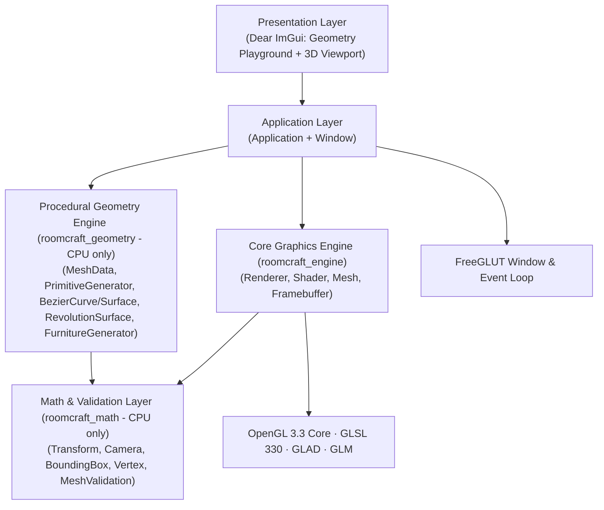

# Kiến trúc phần mềm — RoomCraft 3D (Architecture)

## 1. Kiến trúc tổng thể theo tầng (Milestone M0–M2)

## 2. Phân tách thư viện trong CMake (Acyclic Dependency Graph)

1. **`roomcraft_math` (CPU-only, chỉ phụ thuộc `GLM`)**:
   - `Transform`, `Camera`, `BoundingBox`, `Vertex`, `MeshValidation`.
   - Liên kết trực tiếp bởi `RoomCraft3D_UnitTests` (`M1_UnitTests`).
2. **`roomcraft_geometry` (CPU-only, chỉ phụ thuộc `roomcraft_math`, KHÔNG phụ thuộc OpenGL/FreeGLUT/ImGui)**:
   - `MeshData`, `GeometryUtils`, `PrimitiveGenerator`, `BezierCurve`, `BezierSurface`, `RevolutionSurface`, `FurnitureGenerator`.
   - Liên kết trực tiếp bởi `RoomCraft3D_GeometryUnitTests` (`M2_GeometryUnitTests`) — chạy hoàn toàn không cần OpenGL context.
3. **`roomcraft_engine` (GPU + Window + ImGui, phụ thuộc `roomcraft_geometry`, `GLAD`, `FreeGLUT`, `ImGui`, `OpenGL`)**:
   - `Window`, `Shader`, `Mesh`, `Framebuffer`, `Renderer`, `Application`.
4. **`RoomCraft3D`**: Executable chính hỗ trợ 4 chế độ chạy:
   - Mặc định: **M2 Geometry Playground** tương tác.
   - `--smoke-test`: M0 Regression (`M0_SmokeTest`).
   - `--m1-smoke-test`: M1 Regression (`M1_IntegrationSmokeTest`).
   - `--m2-smoke-test`: M2 Procedural Geometry GPU Integration (`M2_IntegrationSmokeTest`).

## 3. Luồng sinh hình học & hiển thị (CPU → GPU Pipeline)

```mermaid
flowchart LR
    PARAMS["Tham số hình học\n(UI / API)"] --> GEN["roomcraft_geometry\n(Sinh MeshData trên CPU)"]
    GEN --> VALID["MeshData::validate()\nNormal≈1, UV hữu hạn,\nKhông chỉ mục lỗi/suy biến"]
    VALID --> UPLOAD["Application::uploadPlaygroundParts()\nChỉ chạy khi tham số đổi"]
    UPLOAD --> GPU["graphics::Mesh\n(VAO + VBO + EBO)"]
    GPU --> RENDER["Renderer::drawMeshWithMatrix()\nM_world = M_parent * M_local\nSolid / Wireframe (khôi phục GL_FILL)"]
    RENDER --> FBO["Off-screen Framebuffer\n(RGBA8 + DEPTH24_STENCIL8)"]
    FBO --> IMGUI["ImGui::Image\n(UV lật: 0,1 -> 1,0)"]
```

## 4. Quản lý tài nguyên GPU & Regeneration an toàn

- **Không sinh lại mỗi frame**: `regenerateActivePlaygroundGeometry()` chỉ chạy khi tham số thay đổi (với `Auto-regenerate`), người dùng nhấn `Regenerate Mesh` hoặc đổi loại hình học.
- **Transactional swap**: Mọi `Mesh` mới được tạo trên vector tạm; nếu tham số không hợp lệ hoặc upload thất bại, mesh hợp lệ trước đó vẫn được giữ nguyên và hiển thị cảnh báo lỗi.
- **Wireframe state restoration**: `Renderer::endFrame()` luôn khôi phục `glPolygonMode(GL_FRONT_AND_BACK, GL_FILL)` để không ảnh hưởng tới Dear ImGui hay các render pass tiếp theo.
- **Shutdown trước khi hủy context**: `Window::onClose` gọi `Application::shutdownGraphics()` giải phóng toàn bộ `m_activeParts`, overlay meshes, `Framebuffer`, `Shader` và Dear ImGui trước khi FreeGLUT hủy OpenGL context.
