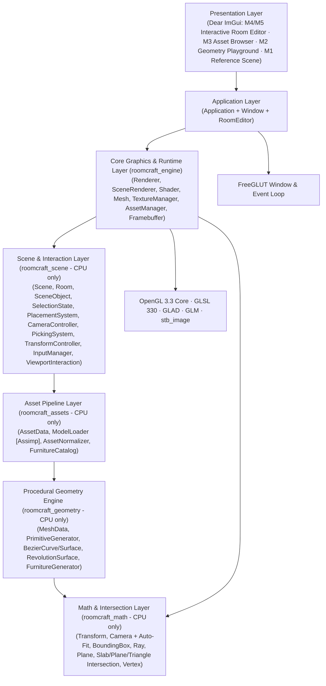

# Kiến trúc phần mềm — RoomCraft 3D (Architecture)

## 1. Kiến trúc tổng thể theo tầng (Milestone M0–M5)

## 2. Phân tách thư viện trong CMake (Acyclic Dependency Graph)

1. **`roomcraft_math` (CPU-only, chỉ phụ thuộc `GLM`)**:
   - `Transform`, `Camera` (`fitBoundingBox`), `BoundingBox`, `Ray`, `ViewportRect`, `Plane`, `Intersection` (Slab AABB, Ray–Plane, Möller–Trumbore Triangle), `Vertex`, `MeshValidation`.
   - Kiểm thử bởi `RoomCraft3D_UnitTests` (`M1_UnitTests`).
2. **`roomcraft_geometry` (CPU-only, phụ thuộc `roomcraft_math`)**:
   - `MeshData`, `GeometryUtils`, `PrimitiveGenerator`, `BezierCurve`, `BezierSurface`, `RevolutionSurface`, `FurnitureGenerator`.
   - Kiểm thử bởi `RoomCraft3D_GeometryUnitTests` (`M2_GeometryUnitTests`).
3. **`roomcraft_assets` (CPU-only, phụ thuộc `roomcraft_geometry` + `assimp`)**:
   - `AssetData`, `ModelLoader`, `AssetNormalizer`, `FurnitureCatalog`.
   - Kiểm thử bởi `RoomCraft3D_AssetUnitTests` (`M3_AssetUnitTests`).
4. **`roomcraft_scene` (CPU-only, phụ thuộc `roomcraft_assets`, KHÔNG phụ thuộc OpenGL/FreeGLUT/ImGui)**:
   - Quản lý cảnh M4: `ObjectId`, `SceneObject`, `RoomSettings`, `Room`, `Scene`, `SelectionState`, `PlacementSystem`, `ScenePresets`.
   - Tương tác M5: `InputManager`, `InteractionState`, `CameraController`, `PickingSystem`, `TransformController`, `ViewportInteraction`.
   - Kiểm thử bởi `RoomCraft3D_SceneUnitTests` (`M4_SceneUnitTests`) và `RoomCraft3D_InteractionUnitTests` (`M5_InteractionUnitTests`).
5. **`roomcraft_engine` (GPU + Window + ImGui, phụ thuộc `roomcraft_scene`, `stb_image`, `GLAD`, `FreeGLUT`, `ImGui`, `OpenGL`)**:
   - `Window`, `Shader`, `Mesh`, `Material`, `Texture`, `TextureManager`, `AssetManager`, `Framebuffer`, `Renderer`, `SceneRenderer`, `RoomEditor`, `Application`.
6. **`RoomCraft3D`**: Executable chính hỗ trợ 8 chế độ chạy:
   - Mặc định: **M4/M5 Interactive Room Editor** (chuyển đổi trực tiếp qua M3/M2/M1 trên thanh menu).
   - `--smoke-test`, `--m1-smoke-test`, `--m2-smoke-test`, `--m3-smoke-test`, `--m4-smoke-test`, `--m4-benchmark`, `--m5-smoke-test`.

## 3. Luồng Định tuyến Đầu vào (FreeGLUT → ImGui + InputManager → ViewportInteraction)

- FreeGLUT callbacks trong `Application` luôn chuyển tiếp đầy đủ mọi sự kiện chuột/bàn phím tới `ImGui_ImplGLUT_*` đồng thời cập nhật `InputManager` (phân biệt `Pressed` 1-frame với `Held`).
- `RoomEditor::renderViewportPanel()` đo chính xác `ImGui::GetItemRectMin()` / `Max()` và `IsItemHovered()`, đóng gói vào `ViewportInputContext` rồi gọi `ViewportInteraction::processInput()` trong cùng khung hình để Inspector, Hierarchy và Viewport luôn đồng bộ tức thì.

Xem thêm chi tiết tại [`docs/CAMERA_SYSTEM.md`](CAMERA_SYSTEM.md), [`docs/OBJECT_PICKING.md`](OBJECT_PICKING.md) và [`docs/INTERACTION_GUIDE.md`](INTERACTION_GUIDE.md).
