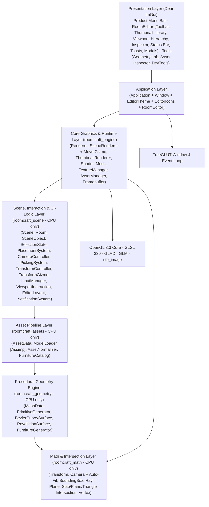

# Kiến trúc phần mềm — RoomCraft 3D (Architecture)

## 1. Kiến trúc tổng thể theo tầng (Milestone M0–M6)

## 2. Phân tách thư viện trong CMake (Acyclic Dependency Graph)

1. **`roomcraft_math` (CPU-only, chỉ phụ thuộc `GLM`)**:
   - `Transform`, `Camera` (`fitBoundingBox`), `BoundingBox`, `Ray`, `ViewportRect`, `Plane`, `Intersection` (Slab AABB, Ray–Plane, Möller–Trumbore Triangle), `Vertex`, `MeshValidation`.
   - Kiểm thử bởi `RoomCraft3D_UnitTests` (`M1_UnitTests`).
2. **`roomcraft_geometry` (CPU-only, phụ thuộc `roomcraft_math`)**:
   - `MeshData`, `GeometryUtils`, `PrimitiveGenerator`, `BezierCurve`, `BezierSurface`, `RevolutionSurface`, `FurnitureGenerator`.
   - Kiểm thử bởi `RoomCraft3D_GeometryUnitTests` (`M2_GeometryUnitTests`).
3. **`roomcraft_assets` (CPU-only, phụ thuộc `roomcraft_geometry` + `assimp`)**:
   - `AssetData`, `ModelLoader`, `AssetNormalizer`, `FurnitureCatalog`.
   - Kiểm thử bởi `RoomCraft3D_AssetUnitTests` (`M3_AssetUnitTests`).
4. **`roomcraft_scene` (CPU-only, phụ thuộc `roomcraft_assets`, KHÔNG phụ thuộc OpenGL/FreeGLUT/ImGui)**:
   - Quản lý cảnh M4: `ObjectId`, `SceneObject`, `RoomSettings`, `Room`, `Scene`, `SelectionState`, `PlacementSystem`, `ScenePresets`.
   - Tương tác M5: `InputManager`, `InteractionState`, `CameraController`, `PickingSystem`, `TransformController`, `ViewportInteraction`.
   - Logic UI & Gizmo M6: `EditorLayout`, `NotificationSystem`, `TransformGizmo`.
   - Kiểm thử bởi `RoomCraft3D_SceneUnitTests` (`M4_SceneUnitTests`), `RoomCraft3D_InteractionUnitTests` (`M5_InteractionUnitTests`) và `RoomCraft3D_EditorUiUnitTests` (`M6_EditorUiUnitTests`).
5. **`roomcraft_engine` (GPU + Window + ImGui, phụ thuộc `roomcraft_scene`, `stb_image`, `GLAD`, `FreeGLUT`, `ImGui`, `OpenGL`)**:
   - Graphics & Assets GPU: `Window`, `Shader`, `Mesh`, `Material`, `Texture`, `TextureManager`, `AssetManager`, `Framebuffer`, `ThumbnailRenderer`, `Renderer`, `SceneRenderer`.
   - Giao diện sản phẩm: `EditorTheme`, `EditorIcons`, `RoomEditor`, `Application`.
6. **`RoomCraft3D`**: Executable chính hỗ trợ 9 chế độ chạy:
   - Mặc định: **RoomCraft 3D — Interactive Room Editor** (menu sản phẩm `Tools` truy cập `Geometry Lab`, `Asset Inspector` và `Developer Tools` mà không mất trạng thái phòng).
   - `--smoke-test`, `--m1-smoke-test`, `--m2-smoke-test`, `--m3-smoke-test`, `--m4-smoke-test`, `--m4-benchmark`, `--m5-smoke-test`, `--m6-smoke-test`.

## 3. Luồng Định tuyến Đầu vào & Workspace Router

- FreeGLUT callbacks trong `Application` chuyển tiếp đầy đủ mọi sự kiện chuột/bàn phím tới `ImGui_ImplGLUT_*` đồng thời cập nhật `InputManager` (phân biệt `Pressed` 1-frame với `Held`).
- `RoomEditor::renderViewportPanel()` đo `ImGui::GetItemRectMin()` / `Max()` và `IsItemHovered()`, gọi `ViewportInteraction::processInput()` với ưu tiên **3-Axis Move Gizmo → Picking → Transform** trong cùng khung hình để Viewport, Hierarchy và Inspector đồng bộ tức thì.
- `Application::switchWorkspace()` lưu trữ riêng `m_roomCameraState` trước khi chuyển sang các công cụ trong menu `Tools` và khôi phục trọn vẹn khi quay về `Room Editor`.

Xem thêm chi tiết tại [`docs/DESIGN_SYSTEM.md`](DESIGN_SYSTEM.md), [`docs/UI_ARCHITECTURE.md`](UI_ARCHITECTURE.md), [`docs/CAMERA_SYSTEM.md`](CAMERA_SYSTEM.md), [`docs/OBJECT_PICKING.md`](OBJECT_PICKING.md) và [`docs/INTERACTION_GUIDE.md`](INTERACTION_GUIDE.md).
