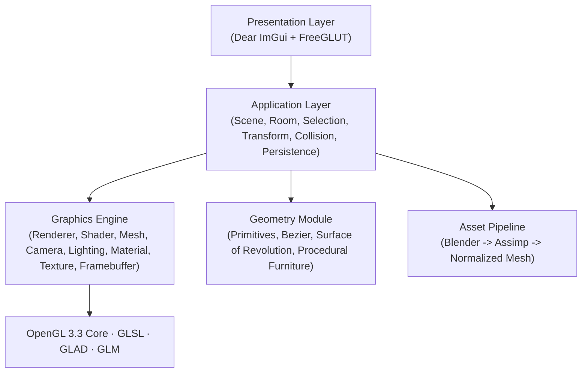

# Kiến trúc phần mềm — RoomCraft 3D (Architecture)

## 1. Kiến trúc tổng thể theo tầng (Layered Modular Architecture)

## 2. Phân rã module mục tiêu

- `core`: Vòng đời ứng dụng (`Application`), cửa sổ FreeGLUT, định tuyến sự kiện đầu vào, ghi log.
- `graphics`: Trừu tượng hóa OpenGL 3.3 Core (`Renderer`, `Shader`, `Mesh`, `Texture`, `Material`, `Camera`, `Framebuffer`, `Light`).
- `geometry`: Thuật toán sinh mesh thủ tục (`PrimitiveGenerator`, `BezierCurve`, `BezierSurface`, `RevolutionSurface`, `FurnitureGenerator`).
- `scene`: Mô hình hóa cảnh 3D (`Scene`, `SceneObject`, `Transform`, `Room`).
- `assets`: Nạp và quản lý tài nguyên dùng chung (`AssetManager`, `ModelLoader`, `FurnitureCatalog`).
- `systems`: Hệ thống tương tác và nghiệp vụ (`CameraController`, `SelectionSystem`, `CollisionSystem`, `GridSystem`, `CommandHistory`).
- `editor`: Các panel Dear ImGui (`Editor`, `MainMenu`, `Toolbar`, `ViewportPanel`, `FurniturePanel`, `HierarchyPanel`, `InspectorPanel`, `StatusBar`).
- `serialization`: Đọc/ghi và kiểm tra tính hợp lệ file project JSON (`ProjectSerializer`, `ProjectValidator`).

## 3. Hiện trạng kiến trúc tại Milestone M0

Tại **Milestone M0 — Project Foundation**, hệ thống chỉ triển khai tầng nền móng tối thiểu theo đúng nguyên tắc tránh tạo class rỗng:

- `src/main.cpp`: Phân tích tham số dòng lệnh (`--smoke-test`, `--help`), khởi chạy `roomcraft::core::Application`.
- `include/roomcraft/core/Application.hpp` & `src/core/Application.cpp`:
  - Khởi tạo cửa sổ FreeGLUT với `OpenGL 3.3 Core Profile` (`glutInitContextVersion(3, 3)`, `glutInitContextProfile(GLUT_CORE_PROFILE)`).
  - Thiết lập `GLUT_ACTION_ON_WINDOW_CLOSE = GLUT_ACTION_GLUTMAINLOOP_RETURNS` và `glutCloseFunc` để giải phóng tài nguyên GPU/ImGui **trước khi** OpenGL context bị hủy.
  - Nạp con trỏ hàm OpenGL qua **GLAD** và kiểm tra phiên bản thực tế ≥ 3.3 Core.
  - Biên dịch và liên kết shader GLSL `#version 330 core` (`assets/shaders/basic.vert`, `assets/shaders/basic.frag`).
  - Khởi tạo VAO/VBO để render tam giác kiểm chứng bằng Modern OpenGL.
  - Tích hợp **Dear ImGui** theo cặp backend `imgui_impl_glut` (sự kiện/cửa sổ FreeGLUT) + `imgui_impl_opengl3` (renderer `#version 330 core`).

## 4. Nguyên tắc thiết kế bắt buộc

1. **Tách biệt logic nghiệp vụ và UI**: Dear ImGui chỉ hiển thị trạng thái và phát lệnh tới các hệ thống cốt lõi.
2. **Quản lý vòng đời GPU an toàn**: Mọi đối tượng VAO/VBO/EBO/Shader/Texture/FBO phải được giải phóng trước khi OpenGL context bị hủy và chống double-delete.
3. **Không sao chép dữ liệu GPU thừa**: Khi nhân bản `SceneObject` (M4+), nhiều vật thể chia sẻ chung `Mesh` trong `AssetManager`.
4. **Đường dẫn tương đối**: Tài nguyên (shader, texture, model, project) luôn được tìm tương đối theo thư mục thực thi hoặc gốc dự án.
