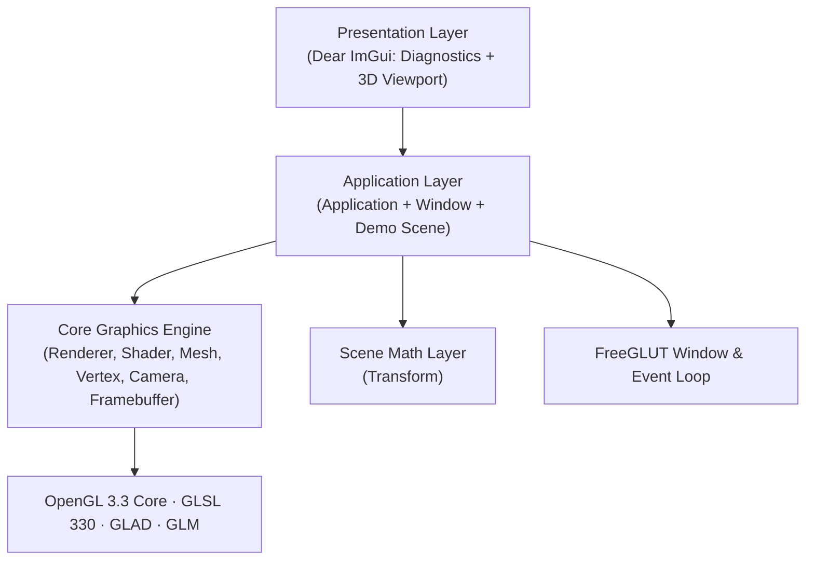
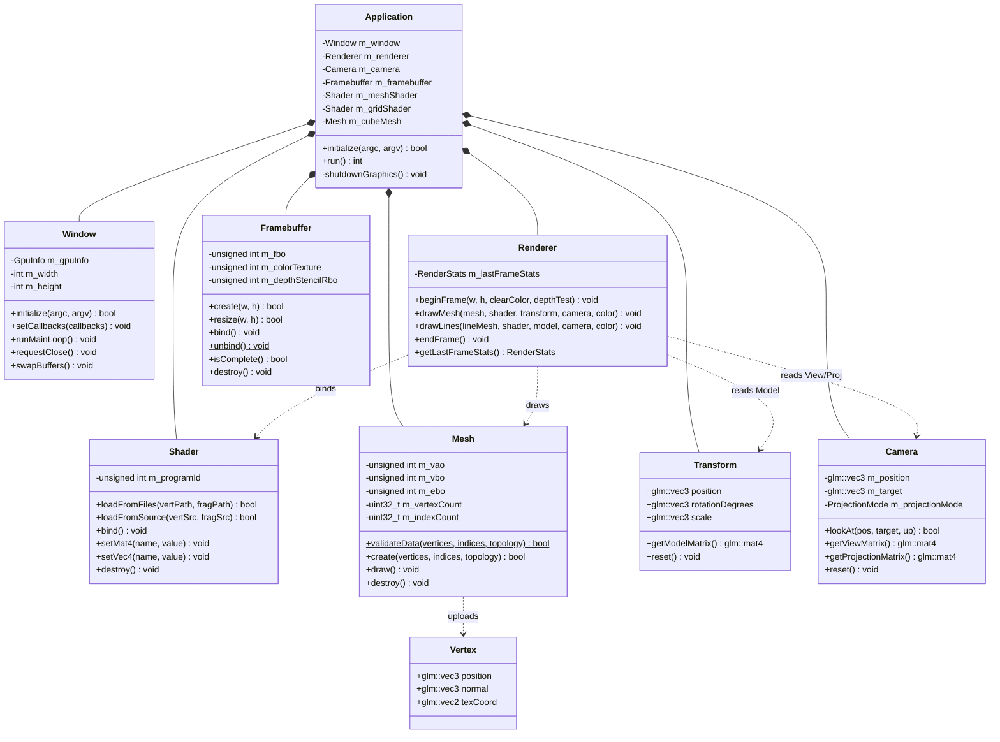

# Kiến trúc phần mềm — RoomCraft 3D (Architecture)

## 1. Kiến trúc tổng thể theo tầng (Layered Modular Architecture)

## 2. Sơ đồ lớp Core Graphics Engine (Milestone M1)

## 3. Luồng Graphics Pipeline (Off-screen Framebuffer -> Dear ImGui Viewport)

```mermaid
flowchart LR
    CPU["CPU Geometry\n(Vertex + Indices)"] --> VAL["Mesh::validateData()"]
    VAL --> GPU["VAO + VBO + EBO\n(GPU Static Buffers)"]
    GPU --> VS["Vertex Shader\n(mesh.vert / grid.vert)\np_clip = P * V * M * p_local"]
    VS --> RAST["Primitive Assembly\n& Rasterization"]
    RAST --> FS["Fragment Shader\n(mesh.frag / grid.frag)"]
    FS --> DEPTH["Depth Testing\n(GL_DEPTH_TEST, GL_LESS)"]
    DEPTH --> FBO["Off-screen Framebuffer\n(RGBA8 Texture + DEPTH24_STENCIL8)"]
    FBO --> IMGUI["ImGui::Image\n(UV flipped: 0,1 -> 1,0)"]
    IMGUI --> SCREEN["Default Framebuffer\n& glutSwapBuffers()"]
```

## 4. Tách lớp thư viện trong CMake (M1)

Để hỗ trợ kiểm thử đơn vị (Unit Testing) độc lập với GPU/OpenGL:
- `roomcraft_math`: Chỉ chứa `Transform`, `Camera` và `MeshValidation` (chỉ phụ thuộc `GLM`). Được liên kết trực tiếp bởi `RoomCraft3D_UnitTests` để chạy nhanh, không cần tạo cửa sổ hay OpenGL context.
- `roomcraft_engine`: Chứa toàn bộ lớp điều khiển OpenGL/FreeGLUT/ImGui (`Window`, `Shader`, `Mesh`, `Framebuffer`, `Renderer`, `Application`).
- `RoomCraft3D`: Executable chính liên kết `roomcraft_engine`, hỗ trợ chế độ tương tác mặc định, `--smoke-test` (M0 regression) và `--m1-smoke-test` (M1 GPU integration).

## 5. Nguyên tắc quản lý vòng đời tài nguyên GPU

- Toàn bộ lớp sở hữu GPU handle (`Shader`, `Mesh`, `Framebuffer`) áp dụng **RAII**: cấm copy (`= delete`), hỗ trợ move (`std::exchange(..., 0)`) và có phương thức `destroy()` idempotent (chống double-delete).
- Callback `Window::onClose` gọi `Application::shutdownGraphics()` **trước khi** FreeGLUT hủy OpenGL context để mọi lệnh `glDelete*` và `ImGui_ImplOpenGL3_Shutdown()` luôn thực thi trên context hợp lệ.
