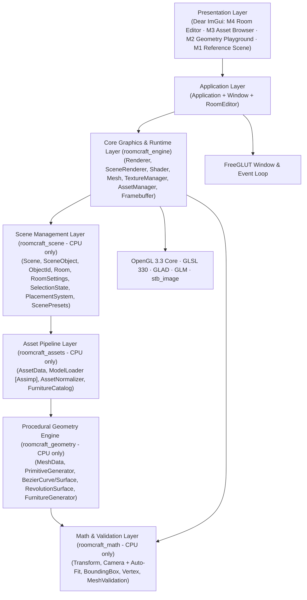

# Kiến trúc phần mềm — RoomCraft 3D (Architecture)

## 1. Kiến trúc tổng thể theo tầng (Milestone M0–M4)

## 2. Phân tách thư viện trong CMake (Acyclic Dependency Graph)

1. **`roomcraft_math` (CPU-only, chỉ phụ thuộc `GLM`)**:
   - `Transform`, `Camera` (kèm `fitBoundingBox()`), `BoundingBox`, `Vertex`, `MeshValidation`.
   - Kiểm thử bởi `RoomCraft3D_UnitTests` (`M1_UnitTests`).
2. **`roomcraft_geometry` (CPU-only, phụ thuộc `roomcraft_math`)**:
   - `MeshData`, `GeometryUtils`, `PrimitiveGenerator`, `BezierCurve`, `BezierSurface`, `RevolutionSurface`, `FurnitureGenerator`.
   - Kiểm thử bởi `RoomCraft3D_GeometryUnitTests` (`M2_GeometryUnitTests`).
3. **`roomcraft_assets` (CPU-only, phụ thuộc `roomcraft_geometry` + `assimp`)**:
   - `AssetData`, `ModelLoader`, `AssetNormalizer`, `FurnitureCatalog`.
   - Kiểm thử bởi `RoomCraft3D_AssetUnitTests` (`M3_AssetUnitTests`).
4. **`roomcraft_scene` (CPU-only, phụ thuộc `roomcraft_assets`, KHÔNG phụ thuộc OpenGL/FreeGLUT/ImGui)**:
   - `ObjectId`, `SceneObject`, `RoomSettings`, `Room`, `Scene`, `SelectionState`, `PlacementSystem`, `ScenePresets`.
   - Kiểm thử bởi `RoomCraft3D_SceneUnitTests` (`M4_SceneUnitTests`) — tạo nền tảng sạch cho Collision (M8), Undo/Redo (M6) và JSON Serialization (M8).
5. **`roomcraft_engine` (GPU + Window + ImGui, phụ thuộc `roomcraft_scene`, `stb_image`, `GLAD`, `FreeGLUT`, `ImGui`, `OpenGL`)**:
   - `Window`, `Shader`, `Mesh`, `Material`, `Texture`, `TextureManager`, `AssetManager`, `Framebuffer`, `Renderer`, `SceneRenderer`, `RoomEditor`, `Application`.
6. **`RoomCraft3D`**: Executable chính hỗ trợ 7 chế độ chạy:
   - Mặc định: **M4 Room Editor** tương tác (chuyển đổi trực tiếp qua M3/M2/M1 trên thanh menu).
   - `--smoke-test`, `--m1-smoke-test`, `--m2-smoke-test`, `--m3-smoke-test`, `--m4-smoke-test`, `--m4-benchmark`.

## 3. Quản lý tài nguyên GPU, Cache & Vòng đời an toàn

- **Chia sẻ tài nguyên GPU (Shared GPU Assets)**: `SceneObject` chỉ lưu `assetId` và `Transform`. `SceneRenderer` tra cứu `std::shared_ptr<GpuAsset>` từ `AssetManager` mỗi khung hình (O(1) hash lookup), bảo đảm nhiều bản sao của cùng nội thất dùng chung VAO/VBO/EBO/Texture và luôn an toàn sau `reloadAsset()`.
- **Đồng bộ lưới phòng theo Revision**: `SceneRenderer::syncRoomGpuMeshes()` chỉ upload lại sàn/tường/trần/lưới khi `Room::getGeometryRevision()` tăng (tức khi kích thước/độ dày/grid thay đổi), không upload lại khi chỉ đổi màu sắc hay ẩn/hiện tường.
- **Transactional updates**: `Room::applySettings()`, `AssetManager::reloadAsset()` và `regenerateActivePlaygroundGeometry()` đều tạo dữ liệu tạm và xác thực trước khi hoán đổi.
- **Shutdown trước khi hủy context**: `Application::shutdownGraphics()` giải phóng tường minh `RoomEditor` (`SceneRenderer`), `AssetManager`, `TextureManager`, `Framebuffer`, `Shader` và Dear ImGui ngay trong `glutCloseFunc` trước khi FreeGLUT hủy OpenGL context.

Xem chi tiết kiến trúc Scene Management tại [`docs/SCENE_MANAGEMENT.md`](SCENE_MANAGEMENT.md) và Asset Pipeline tại [`docs/ASSET_PIPELINE.md`](ASSET_PIPELINE.md).
