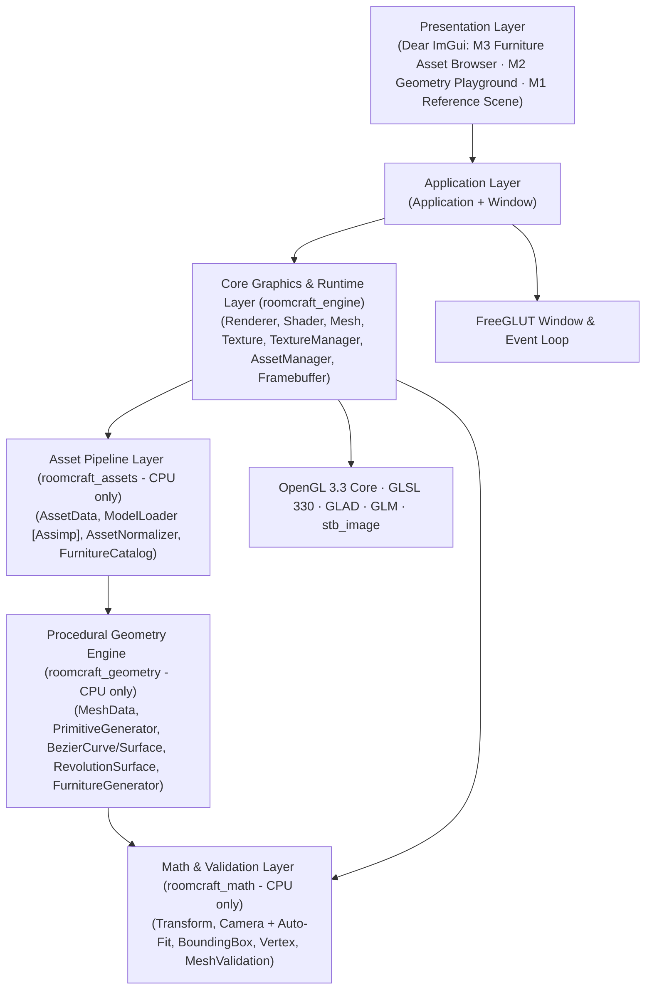
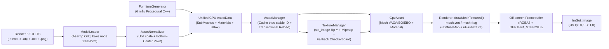

# Kiến trúc phần mềm — RoomCraft 3D (Architecture)

## 1. Kiến trúc tổng thể theo tầng (Milestone M0–M3)

## 2. Phân tách thư viện trong CMake (Acyclic Dependency Graph)

1. **`roomcraft_math` (CPU-only, chỉ phụ thuộc `GLM`)**:
   - `Transform`, `Camera` (bao gồm `fitBoundingBox()`), `BoundingBox`, `Vertex`, `MeshValidation`.
   - Liên kết trực tiếp bởi `RoomCraft3D_UnitTests` (`M1_UnitTests`).
2. **`roomcraft_geometry` (CPU-only, chỉ phụ thuộc `roomcraft_math`)**:
   - `MeshData`, `GeometryUtils`, `PrimitiveGenerator`, `BezierCurve`, `BezierSurface`, `RevolutionSurface`, `FurnitureGenerator`.
   - Liên kết trực tiếp bởi `RoomCraft3D_GeometryUnitTests` (`M2_GeometryUnitTests`) — chạy hoàn toàn không cần OpenGL context.
3. **`roomcraft_assets` (CPU-only, phụ thuộc `roomcraft_geometry` và `assimp::assimp`, KHÔNG phụ thuộc OpenGL/FreeGLUT/ImGui)**:
   - `AssetData` (`SubMeshData`, `MaterialData`, `AssetData` dùng chung cho cả Procedural và Blender), `ModelLoader`, `AssetNormalizer`, `FurnitureCatalog`.
   - Liên kết trực tiếp bởi `RoomCraft3D_AssetUnitTests` (`M3_AssetUnitTests`) — kiểm thử độc lập toàn bộ luồng import/chuẩn hóa/catalog mà không cần GPU context.
4. **`roomcraft_engine` (GPU + Window + ImGui, phụ thuộc `roomcraft_assets`, `stb_image`, `GLAD`, `FreeGLUT`, `ImGui`, `OpenGL`)**:
   - `Window`, `Shader`, `Mesh`, `Material`, `Texture`, `TextureManager`, `AssetManager`, `Framebuffer`, `Renderer`, `Application`.
5. **`RoomCraft3D`**: Executable chính hỗ trợ 5 chế độ chạy:
   - Mặc định: **M3 Furniture Asset Browser** tương tác (có thể chuyển qua M2 Geometry Playground và M1 Reference Scene trên thanh công cụ).
   - `--smoke-test`: M0 Regression (`M0_SmokeTest`).
   - `--m1-smoke-test`: M1 Regression (`M1_IntegrationSmokeTest`).
   - `--m2-smoke-test`: M2 Procedural Geometry GPU Integration (`M2_IntegrationSmokeTest`).
   - `--m3-smoke-test`: M3 Blender Asset Pipeline GPU Integration (`M3_IntegrationSmokeTest`).

## 3. Luồng Hybrid Asset Pipeline (Blender & Procedural → Unified Asset → GPU)

## 4. Quản lý tài nguyên GPU, Cache & Transactional Reload

- **Không tải lại / không sinh lại mỗi frame**: `AssetManager::getOrLoad(assetId)` và `TextureManager::getOrLoad(path)` tái sử dụng GPU handle đã cache; `M2` chỉ tái sinh hình học khi tham số thay đổi.
- **Transactional swap**: Cả `AssetManager::reloadAsset()` và `regenerateActivePlaygroundGeometry()` đều xây dựng toàn bộ tài nguyên GPU mới trên biến tạm trước; chỉ khi hợp lệ mới hoán đổi (`std::move`) vào cache. Nếu file bị lỗi/thiếu, asset hợp lệ đang hiển thị vẫn được giữ nguyên và UI báo lỗi rõ ràng.
- **Wireframe state restoration**: `Renderer::endFrame()` luôn khôi phục `glPolygonMode(GL_FRONT_AND_BACK, GL_FILL)` để không ảnh hưởng tới Dear ImGui hay các render pass kế tiếp.
- **Shutdown trước khi hủy context**: `Window::onClose` gọi `Application::shutdownGraphics()` giải phóng tường minh `AssetManager` (GPU meshes), `TextureManager` (GL textures + fallback), `m_activeParts`, overlay meshes, `Framebuffer`, `Shader` và Dear ImGui **trước khi** FreeGLUT hủy OpenGL context.
