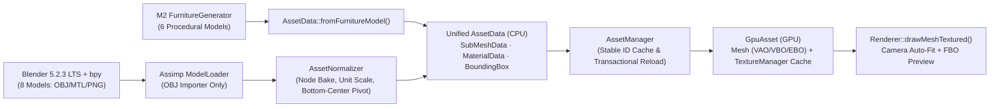

# Quy trình tài nguyên — RoomCraft 3D (Asset Pipeline)

Tài liệu này mô tả kiến trúc **Hybrid Modeling** và luồng xử lý tài nguyên (Asset Pipeline) được triển khai tại **Milestone M3** của **RoomCraft 3D**.

---

## 1. Chiến lược Hybrid Modeling (Procedural C++ + Blender Assets)

RoomCraft 3D kết hợp có chủ đích hai nguồn mô hình 3D:
1. **Procedural Modeling (thuần C++ — Milestone M2)**: 6 mẫu nội thất (`Desk`, `Chair`, `Bookshelf`, `Desk Lamp`, `Ceramic Vase`, `Curved Chair`) sinh trực tiếp từ `PrimitiveGenerator`, `BezierCurve`, `BezierSurface` và `RevolutionSurface`. Các mẫu này thể hiện chiều sâu thuật toán Computer Graphics và **không** bị thay thế bởi mô hình Blender.
2. **Asset-based Modeling (Blender + Assimp — Milestone M3)**: 8 mẫu nội thất có đường nét phức tạp hơn theo phong cách *Stylized Low-poly / Scandinavian Modern* (`Modern Sofa`, `Modern Bed`, `Gaming Chair`, `Computer Setup`, `Indoor Plant`, `Floor Lamp`, `Wardrobe`, `Minimalist Carpet`) được tạo bằng Blender Python API (`bpy`), lưu nguồn `.blend` và xuất `.obj` + `.mtl` + `.png`.

Cả hai nguồn đều hội tụ về một cấu trúc dữ liệu CPU thống nhất (`AssetData`) và một tầng quản lý tài nguyên GPU thống nhất (`AssetManager` + `GpuAsset`), giúp `Renderer` vẽ mọi món nội thất theo cùng một pipeline mà không cần phân biệt nguồn gốc.

---

## 2. Sơ đồ luồng Asset Pipeline (CPU → GPU)

---

## 3. Các thành phần cốt lõi trong Asset Pipeline

### 3.1. Định dạng Wavefront OBJ / MTL & Assimp Import
- **OBJ** lưu danh sách đỉnh (`v`), tọa độ texture (`vt`), pháp tuyến (`vn`), mặt đa giác (`f`), phân tách đối tượng (`o`/`g`) và vật liệu (`usemtl`).
- **MTL** lưu thuộc tính vật liệu cơ bản: màu khuếch tán (`Kd`), phản xạ (`Ks`), độ bóng (`Ns`), độ trong suốt (`d`) và đường dẫn ảnh texture (`map_Kd`).
- **Assimp (`v6.0.6`, liên kết tĩnh, chỉ bật OBJ Importer)** nạp file với các cờ:
  - `aiProcess_Triangulate`: chuyển mọi mặt tứ giác/đa giác sang tam giác.
  - `aiProcess_JoinIdenticalVertices`: gộp đỉnh trùng lặp giảm bộ nhớ VBO.
  - `aiProcess_GenSmoothNormals`: chỉ tự sinh pháp tuyến nếu model gốc bị thiếu `vn`.
  - `aiProcess_ValidateDataStructure`: kiểm tra toàn vẹn cấu trúc dữ liệu.
  - **Không** dùng `aiProcess_FlipUVs` và **không** dùng `aiProcess_MakeLeftHanded`.

### 3.2. Cây Node Hierarchy & Chuyển đổi ma trận Assimp → GLM
- `ModelLoader` duyệt đệ quy từ `aiScene::mRootNode` và tích lũy ma trận thế giới $M_{\text{world}} = M_{\text{parent}} \cdot M_{\text{node}}$.
- Assimp lưu ma trận theo **hàng (row-major)** trong khi GLM lưu theo **cột (column-major)**. `ModelLoader::convertMatrix()` chuyển đổi tường minh từng phần tử (`out[col][row] = m[row][col]`), tuyệt đối không dùng `memcpy`.
- `AssetNormalizer::bakeTransformIntoMesh()` nướng $M_{\text{world}}$ vào đỉnh, biến đổi pháp tuyến bằng ma trận nghịch đảo chuyển vị $(M_{3\times3}^{-1})^T$ (xử lý chính xác non-uniform scaling), phát hiện ma trận suy biến ($\det \approx 0$) và tự động đảo chiều quấn tam giác nếu $\det < 0$ (phép phản xạ) để bảo toàn chuẩn CCW.

### 3.3. Chuẩn hóa hệ tọa độ, tỷ lệ và Pivot tâm đáy
- **Hệ tọa độ**: Chuyển đổi trục **một lần duy nhất** khi xuất từ Blender (`Up = Y`, `Forward = -Z`, `Scale = 1.0`). `ModelLoader` không chuyển trục lần hai.
- **Tỷ lệ vật lý (Unit Scale)**: Hỗ trợ tham số `unitScale` tường minh (ví dụ `0.01` cho file xuất theo cm), tuyệt đối không ép mọi mô hình về khối lập phương đơn vị (unit cube) để giữ đúng tỷ lệ giữa sofa, giường và bình hoa.
- **Bottom-Center Pivot**: Tính tổng hộp bao `BoundingBox` trên mọi submesh, tính điểm tâm đáy:
  $$P_{\text{pivot}} = \left(\frac{x_{\min} + x_{\max}}{2},\; y_{\min},\; \frac{z_{\min} + z_{\max}}{2}\right)$$
  và dịch toàn bộ submesh đồng nhất theo $-P_{\text{pivot}}$ sao cho vật thể luôn đứng khít trên mặt sàn $y = 0$.

### 3.4. Vật liệu (`MaterialData`), Texture (`stb_image`) & Hướng UV
- `Texture` sử dụng `stb_image` với `stbi_set_flip_vertically_on_load(1)` để hàng ảnh dưới cùng tương ứng $v = 0$ của OpenGL (nhất quán với việc tắt `aiProcess_FlipUVs`), đặt `GL_UNPACK_ALIGNMENT = 1` tránh lệch ảnh có chiều rộng không chia hết cho 4, sinh mipmap và quản lý handle theo RAII move-only.
- Nếu file texture thiếu hoặc hỏng, `TextureManager` tự động kích hoạt **Fallback Checker Texture** và ghi cảnh báo (không crash).
- *Giới hạn M3*: Shader preview M3 mới dùng `baseColor` và `diffuseTexture`; các trường `specularColor`, `shininess`, `opacity` được lưu sẵn trong `MaterialData` phục vụ **Milestone M7**.

### 3.5. Caching, Transactional Reload & Camera Auto-Fit
- **Texture Cache (`TextureManager`)**: Khóa cache theo đường dẫn chuẩn hóa (`weakly_canonical`, không phân biệt hoa/thường trên Windows), tránh nạp cùng một PNG nhiều lần.
- **Asset Cache (`AssetManager`)**: Khóa theo **stable Asset ID** (`blender-modern-sofa`, `procedural-desk`, ...), chia sẻ `std::shared_ptr<GpuAsset>` để không nhân bản VAO/VBO/EBO.
- **Transactional Reload**: Khi nhấn `Reload Asset`, hệ thống nạp CPU → kiểm tra hợp lệ → upload GPU mới hoàn chỉnh trước rồi mới thay thế cache; nếu lỗi (ví dụ file OBJ bị hỏng/xóa), asset hợp lệ cũ vẫn được giữ nguyên.
- **Camera Auto-Fit (`Camera::fitBoundingBox`)**: Chiếu nửa kích thước AABB lên 3 trục camera $(R, U, F)$ để tính khoảng cách nhìn tối ưu (Perspective) hoặc `orthoHalfHeight` (Orthographic) theo tỷ lệ khung hình ngang/dọc với hệ số đệm `paddingFactor`.
