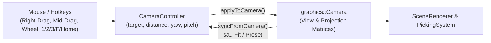

# Hệ thống Điều khiển Camera — RoomCraft 3D (Camera System — M5)

Tài liệu này giải thích cơ sở toán học và kiến trúc của **`CameraController`** ([CameraController.hpp](file:///d:/CG/include/roomcraft/systems/CameraController.hpp), [CameraController.cpp](file:///d:/CG/src/systems/CameraController.cpp)) thuần CPU trong thư viện `roomcraft_scene`.

---

## 1. Tọa độ cầu (Spherical Coordinates) & Orbit Camera

Camera quay quanh điểm mục tiêu $\mathbf{T} = (T_x, T_y, T_z)$ theo bán kính $r \in [0.5, 60.0]\text{ m}$, góc ngang $\theta$ (`yawDegrees`) và góc nâng $\phi$ (`pitchDegrees`, kẹp trong $[-85^\circ, +85^\circ]$ để tránh điểm kỳ dị tại cực khi hướng nhìn song song trục $+Y$):

$$x = r \cos(\phi)\cos(\theta), \qquad y = r \sin(\phi), \qquad z = r \cos(\phi)\sin(\theta)$$
$$\mathbf{P}_{\text{camera}} = \mathbf{T} + (x, y, z)$$

### Mã giả Orbit Camera
```text
function orbit(deltaX, deltaY):
    yaw   = wrapAngle(yaw + deltaX * orbitSensitivity, -180°, +180°)
    pitch = clamp(pitch + deltaY * orbitSensitivity, -85°, +85°)
    offset = (r * cos(pitch) * cos(yaw), r * sin(pitch), r * cos(pitch) * sin(yaw))
    camera.lookAt(target + offset, target, up=(0, 1, 0))
    camera.setClipPlanes(clamp(r * 0.01, 0.02, 0.5), max(100.0, r * 8.0))
```

---

## 2. Camera Pan (Hệ cơ sở trực chuẩn `Right` & `TrueUp`)

Khi người dùng giữ **chuột giữa** kéo $(\Delta x, \Delta y)$ trên ảnh viewport chiều cao $H_{\text{vp}}$:

$$\mathbf{F} = \text{normalize}(\mathbf{T} - \mathbf{P}), \qquad \mathbf{R} = \text{normalize}(\mathbf{F} \times \mathbf{U}_{\text{ref}}), \qquad \mathbf{U} = \text{normalize}(\mathbf{R} \times \mathbf{F})$$

Tỷ lệ mét trên mỗi pixel màn hình tự thích nghi theo chế độ chiếu:
- **Perspective**: $\text{unitsPerPixel} = \dfrac{2 \cdot r \cdot \tan(\text{FOV}_y / 2)}{H_{\text{vp}}}$
- **Orthographic**: $\text{unitsPerPixel} = \dfrac{2 \cdot \text{orthoHalfHeight}}{H_{\text{vp}}}$

Cả $\mathbf{P}$ và $\mathbf{T}$ cùng dịch chuyển đồng bộ theo $\Delta \mathbf{s} = (-\mathbf{R}\cdot \Delta x + \mathbf{U}\cdot \Delta y)\cdot \text{unitsPerPixel}$, bảo toàn nguyên vẹn hướng nhìn.

---

## 3. Camera Zoom (Không scale cảnh 3D)

- **Perspective**: Nhân khoảng cách $r \leftarrow \text{clamp}\big(r \cdot (1 - k_{\text{zoom}})^{\Delta w},\; 0.5,\; 60.0\big)$ rồi tính lại vị trí trên mặt cầu.
- **Orthographic**: Nhân nửa chiều cao khung chiếu $\text{orthoHalfHeight} \leftarrow \text{clamp}\big(\text{orthoHalfHeight} \cdot (1 - k_{\text{zoom}})^{\Delta w},\; 0.3,\; 40.0\big)$.

---

## 4. Đồng bộ Presets & Focus (`syncFromCamera`)

Mọi thao tác chuyển góc nhìn (`Top View [1]`, `Perspective [2]`, `Isometric [3]`, `Front`, `Fit Room [Home]`, `Fit Selected [F]`) đều gọi `syncFromCamera(camera)` để nghịch đảo ngược $(r, \theta, \phi, \mathbf{T})$ từ vị trí mới của camera:
$$\phi = \arcsin\!\left(\frac{P_y - T_y}{r}\right), \qquad \theta = \text{atan2}(P_z - T_z,\; P_x - T_x)$$
Nhờ đó khi bắt đầu Orbit ngay sau `Fit Room` hoặc `Fit Selected`, camera **không bao giờ bị nhảy ngược** về vị trí cũ.


