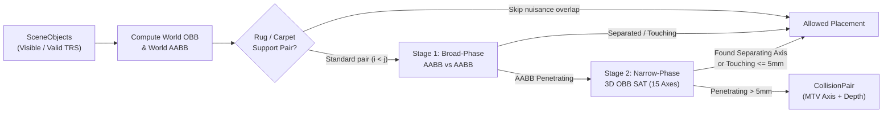

# Hệ thống Phát hiện Va chạm & Xác thực Bố trí — RoomCraft 3D (Collision System — M8)

Tài liệu này trình bày cơ sở toán học Computer Graphics và kiến trúc phần mềm của hệ thống **Collision Detection & Room Boundary Validation** trong **RoomCraft 3D** tại **Milestone M8 (`v0.8.0`)**.

---

## 1. Phạm vi & Triết lý Thiết kế

- **Thuần CPU, độc lập GPU**: Toàn bộ toán học nằm ở `roomcraft_math` (`BoundingBox`, `OBB`, `SATIntersection`) và điều phối ở `roomcraft_scene` (`CollisionSystem`, `RoomBoundaryValidator`), không phụ thuộc OpenGL/FreeGLUT/Dear ImGui.
- **Hỗ trợ bố trí nội thất (Mini CAD), không phải Physics Engine**: Hệ thống kiểm tra giao cắt hình học hộp bao để cảnh báo hoặc ngăn chặn đặt đồ chồng lấn / vượt tường. Không mô phỏng trọng lực, động lực học vật rắn hay phản xạ xung lực.
- **Giới hạn đã biết (Ghi nhận trung thực)**: OBB vẫn là hộp bao lồi xấp xỉ hình học thực. Với các đồ vật rỗng (như gầm bàn hay ghế chữ L), hai OBB có thể chồng lấn dù lưới tam giác không chạm nhau — do đó chế độ mặc định là **`Warning Only`**, tránh chặn quá cứng gây cản trở bố trí hợp lệ.

---

## 2. Biến đổi Hộp bao Cục bộ → World AABB & World OBB

RoomCraft 3D sử dụng ma trận Model dạng **TRS không có biến dạng cắt (no shear)**:
$$M = T \cdot R_y(\text{yaw}) \cdot R_x(\text{pitch}) \cdot R_z(\text{roll}) \cdot S, \qquad S = \text{diag}(s_x, s_y, s_z),\; s_i \ge 10^{-4}$$

### 2.1. Dựng World-space OBB (`OBB::fromLocalBoundsAndTransform`)
Do phép co giãn trục $S$ áp dụng **trước** phép xoay trực chuẩn $R = R_y R_x R_z$, hộp cục bộ $[b_{\min}, b_{\max}]$ có tâm $c_L = \frac{b_{\min}+b_{\max}}{2}$ và bán kích thước $h_L = \frac{b_{\max}-b_{\min}}{2}$ biến đổi chính xác thành một OBB trực giao:
- **3 trục cơ sở đơn vị trong không gian thế giới**:
  $$\mathbf{u}_0 = \text{normalize}(R \mathbf{e}_x),\quad \mathbf{u}_1 = \text{normalize}(R \mathbf{e}_y),\quad \mathbf{u}_2 = \text{normalize}(R \mathbf{e}_z)$$
- **Tâm thế giới**:
  $$\mathbf{C} = \mathbf{T} + R \cdot (S \cdot \mathbf{c}_L)$$
- **Bán kích thước thế giới (hỗ trợ Non-uniform Scale)**:
  $$\mathbf{h} = \big(|s_x| h_{L,x},\; |s_y| h_{L,y},\; |s_z| h_{L,z}\big)$$

> **Xử lý suy biến**: Nếu `localBounds` không hợp lệ, hoặc `position`/`rotation` chứa `NaN`/`Inf`, hoặc bất kỳ thành phần `scale <= 0`, hàm từ chối tường minh (`valid = false`) thay vì sinh ra ma trận suy biến. Một ma trận affine tùy ý chứa *shear* sẽ không giữ trực giao giữa các trục và không thể biểu diễn chính xác bằng OBB; quy ước TRS của `Transform` đảm bảo không phát sinh shear.

### 2.2. Dựng World-space AABB từ OBB (`OBB::toWorldAABB`)
Bán kích thước của World AABB nhỏ nhất bao bọc OBB dọc trục thế giới $k \in \{x, y, z\}$ là tổng hình chiếu:
$$e_{\text{world},k} = |u_{0,k}| h_x + |u_{1,k}| h_y + |u_{2,k}| h_z$$
$$B_{\min} = \mathbf{C} - \mathbf{e}_{\text{world}}, \qquad B_{\max} = \mathbf{C} + \mathbf{e}_{\text{world}}$$

---

## 3. Pipeline 2 Giai đoạn: AABB Broad-Phase → 3D OBB SAT Narrow-Phase

### 3.1. Giai đoạn 1 — Broad-Phase AABB (`intersectAABB`)
Với hai AABB $A, B$, độ chồng lấn trên từng trục $k \in \{x, y, z\}$ là:
$$o_k = \min(A_{\max,k}, B_{\max,k}) - \max(A_{\min,k}, B_{\min,k}), \qquad o_{\min} = \min(o_x, o_y, o_z)$$
Phân loại 3 trạng thái tiếp xúc theo dung sai xuyên lún $\varepsilon_{\text{pen}}$ (mặc định `5 mm` = `0.005 m` trong Editor):
- **`Separated`**: $o_{\min} < -\varepsilon_{\text{pen}}$
- **`Touching`**: $-\varepsilon_{\text{pen}} \le o_{\min} \le \varepsilon_{\text{pen}}$ *(ví dụ đèn đặt trên mặt bàn $y = 0.75\text{ m}$ hoặc hai tủ kê khít nhau)*
- **`Penetrating`**: $o_{\min} > \varepsilon_{\text{pen}}$ → Chuyển tiếp sang Giai đoạn 2.

### 3.2. Giai đoạn 2 — Separating Axis Theorem (SAT) cho 3D OBB (`SATIntersection::testOBB`)
**Định lý Trục Phân tách (SAT)**: Hai hình hộp lồi 3D $A$ và $B$ tách rời khi và chỉ khi tồn tại một trục đơn vị $\mathbf{L}$ mà khoảng cách hình chiếu giữa hai tâm lớn hơn tổng hai bán kính hình chiếu:
$$|(\mathbf{C}_B - \mathbf{C}_A) \cdot \mathbf{L}| > r_A(\mathbf{L}) + r_B(\mathbf{L})$$
trong đó bán kính hình chiếu của hộp $X$ lên trục đơn vị $\mathbf{L}$ là:
$$r_X(\mathbf{L}) = |\mathbf{L} \cdot \mathbf{u}_{X,0}| h_{X,x} + |\mathbf{L} \cdot \mathbf{u}_{X,1}| h_{X,y} + |\mathbf{L} \cdot \mathbf{u}_{X,2}| h_{X,z}$$

**15 trục ứng viên cần kiểm tra**:
1. **3 trục mặt của A**: $\mathbf{u}_{A,0},\; \mathbf{u}_{A,1},\; \mathbf{u}_{A,2}$
2. **3 trục mặt của B**: $\mathbf{u}_{B,0},\; \mathbf{u}_{B,1},\; \mathbf{u}_{B,2}$
3. **9 trục cạnh–cạnh (tích có hướng)**: $\mathbf{u}_{A,i} \times \mathbf{u}_{B,j}$ với $i, j \in \{0, 1, 2\}$

**Ổn định số học (Near-Parallel Axes)**:
- Khi một cạnh của $A$ gần song song với cạnh của $B$, tích có hướng $\mathbf{L}_{\text{raw}} = \mathbf{u}_{A,i} \times \mathbf{u}_{B,j}$ tiến về vector $\mathbf{0}$. Nếu $\|\mathbf{L}_{\text{raw}}\|^2 \le \varepsilon_{\text{axis}}^2$ ($\varepsilon_{\text{axis}} = 10^{-5}$), trục đó bị suy biến và được bỏ qua an toàn (khi hai cạnh song song, mặt phẳng phân tách đã được bao phủ bởi 6 trục mặt của $A$ và $B$).
- Mọi trục hợp lệ đều được chuẩn hóa đơn vị $\mathbf{L} = \mathbf{L}_{\text{raw}} / \|\mathbf{L}_{\text{raw}}\|$ để độ xuyên lún $\text{overlap} = (r_A + r_B) - |(\mathbf{C}_B - \mathbf{C}_A)\cdot\mathbf{L}|$ có đơn vị **mét thực**, đảm bảo đối xứng `testOBB(A, B) == testOBB(B, A)` và nhất quán ngưỡng `Touching` vs `Penetrating`.

---

## 4. Xác thực Giới hạn Phòng (`RoomBoundaryValidator`)

Phòng có không gian sử dụng bên trong $I = [-\frac{W}{2}, +\frac{W}{2}] \times [0, H] \times [-\frac{L}{2}, +\frac{L}{2}]$.
- Kiểm tra **World AABB tính từ World OBB đã xoay và scale** (không bao giờ chỉ kiểm tra tọa độ tâm `position`!).
- Báo cáo chi tiết từng mặt vi phạm: `West (-X)`, `East (+X)`, `North (-Z)`, `South (+Z)`, `Floor (-Y)`, `Ceiling (+Y)` kèm `maxViolationDepth`.
- **Bảo toàn vị trí nâng hợp lệ**: Đèn bàn, bộ máy tính đặt tại $y = 0.75\text{ m}$ hoặc bình hoa trên bàn cà phê $y = 0.45\text{ m}$ hoàn toàn hợp lệ miễn nằm trong $[0, H]$.
- **Resize phòng không phá dữ liệu**: Khi thu nhỏ phòng, không tự động xóa hay tự di chuyển đồ nội thất; hệ thống chạy kiểm tra lại và hiển thị cảnh báo cho các vật thể nay đã vượt ra ngoài biên mới.

---

## 5. Chính sách Tích hợp Editor (`PlacementValidationMode`)

| Chế độ | Hành vi |
|---|---|
| **`Off`** | Tắt cảnh báo và kiểm tra va chạm |
| **`Warning Only`** *(Mặc định)* | Tô khung cảnh báo (hổ phách: va chạm, đỏ san hô: vượt biên phòng), liệt kê tên vật xung đột trong Inspector và tổng hợp trên Status Bar; vẫn cho phép người dùng đặt tự do |
| **`Prevent Invalid`** | Khi thêm mới hoặc kết thúc kéo Move/Rotate/Scale/chỉnh Inspector ở vị trí vi phạm, khôi phục về Transform hợp lệ trước đó kèm Toast cảnh báo (không mở modal làm gián đoạn chuột) |

- **Đối tượng ẩn (`visible = false`)**: Mặc định **không** tham gia kiểm tra va chạm (`includeHiddenObjects = false`), tránh cảnh báo bóng ma từ đồ đã ẩn.
- **Thảm trải sàn (`allowRugOverlap = true`)**: Tự nhận diện `blender-carpet` hoặc vật phủ sàn mỏng ($h \le 4\text{ cm}, y \le 2\text{ cm}$) để đồ nội thất kê trên thảm không bị chặn hay cảnh báo giả.
- **Tối ưu hiệu năng**: Chỉ cập nhật `SceneCollisionReport` khi có thay đổi (dirty flag), không chạy $O(N^2)$ mỗi khung hình khi nhàn rỗi; khi kéo 1 vật thể dùng kiểm tra tăng dần $O(N)$ (`validateCandidateObject`).
