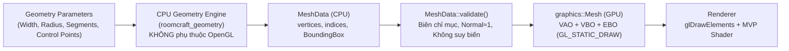
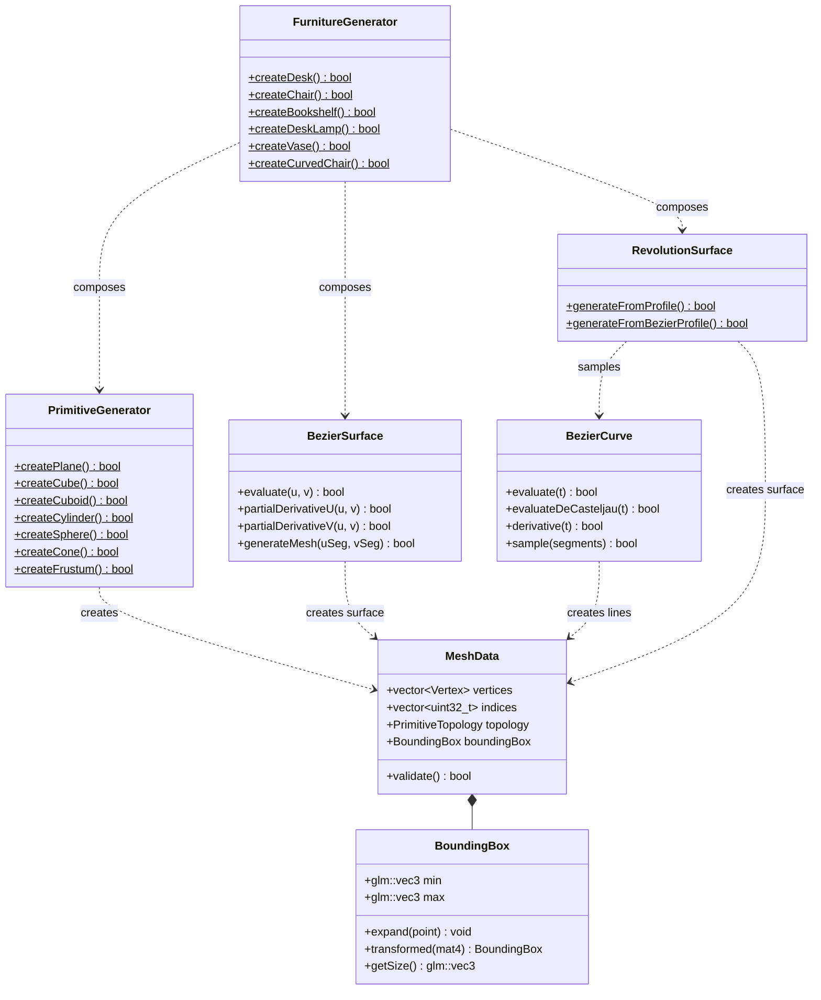

# Thuật toán sinh hình học thủ tục — RoomCraft 3D (Geometry Algorithms)

Tài liệu này trình bày chi tiết các thuật toán Computer Graphics được triển khai bằng C++17 thuần CPU trong module `roomcraft_geometry` (Milestone M2), giải thích cách chuyển đổi từ phương trình toán học sang dữ liệu đỉnh (`Vertex`) và chỉ mục tam giác (`indices`) để nạp lên GPU.

---

## 1. Procedural Modeling & Parametric Modeling

- **Procedural Modeling (Mô hình hóa thủ tục)**: Sinh toàn bộ hình học 3D bằng thuật toán C++ thay vì nhập lưới tĩnh từ phần mềm ngoài. Trong RoomCraft 3D, tuyệt đối **không** dùng `glutSolidCube`/`glutSolidSphere`/`glutSolidCylinder`; mọi tọa độ đỉnh, vector pháp tuyến, UV và chỉ mục tam giác đều do mã nguồn tự tính.
- **Parametric Modeling (Mô hình hóa tham số)**: Hình dạng vật thể được điều khiển bởi các tham số trực quan có đơn vị vật lý (mét) và độ phân giải lưới (`width`, `height`, `radius`, `segments`, `controlPoints`). Khi người dùng thay đổi tham số trong **Geometry Playground**, bộ sinh hình học tính lại `MeshData` mới trên CPU rồi chỉ upload lại GPU khi dữ liệu thực sự thay đổi.

---

## 2. Kiến trúc tách biệt CPU → GPU (Data Flow)





---

## 3. Vertex, Triangle Mesh, Triangle Winding, Normal & UV Seam

### 3.1. Vertex & Triangle Mesh
Mọi bề mặt 3D được xấp xỉ bởi lưới tam giác vì 3 điểm không thẳng hàng luôn đồng phẳng và GPU tối ưu hóa rasterization cho tam giác. Mỗi đỉnh gồm 32 byte (`position`, `normal`, `texCoord`), kết hợp mảng `indices` (`uint32_t`) để tái sử dụng đỉnh chung giữa các tam giác kề nhau.

### 3.2. Triangle Winding (Chiều quấn tam giác CCW)
RoomCraft 3D tuân theo quy ước **ngược chiều kim đồng hồ (Counter-Clockwise — CCW)** khi nhìn từ bên ngoài bề mặt. Với tam giác `(p0, p1, p2)`, vector pháp tuyến hình học hướng ra ngoài thỏa mãn quy tắc bàn tay phải:
$$\vec{n}_{\text{face}} = \frac{(p_1 - p_0) \times (p_2 - p_0)}{\|(p_1 - p_0) \times (p_2 - p_0)\|}, \quad \vec{n}_{\text{face}} \cdot \vec{n}_{\text{vertex}} > 0$$

### 3.3. Tính Vector Pháp tuyến (Normal Calculation)
Không dùng vector mặc định `(0, 1, 0)` cho mọi hình học; mỗi đối tượng dùng công thức pháp tuyến chính xác theo bản chất hình học:
- **Plane / Cuboid**: Pháp tuyến phẳng riêng biệt cho từng mặt (vì vậy hình hộp cần **24 đỉnh** thay vì 8 đỉnh để cạnh sắc không bị nội suy pháp tuyến sai giữa hai mặt vuông góc).
- **Cylinder**: Pháp tuyến tỏa tròn $(\cos\theta, 0, \sin\theta)$ cho thân trụ, tách đỉnh riêng với pháp tuyến phẳng $(0, +1, 0)$ và $(0, -1, 0)$ cho hai nắp.
- **Sphere**: Pháp tuyến giải tích $\vec{n} = (\sin\phi\cos\theta, \cos\phi, \sin\phi\sin\theta)$ luôn có độ dài chính xác bằng 1.
- **Cone / Frustum**: Với độ nghiêng $\Delta r = r_{\text{bottom}} - r_{\text{top}}$ và chiều cao $h$, pháp tuyến mặt bên nghiêng vuông góc với đường sinh:
  $$n_r = \frac{h}{\sqrt{h^2 + \Delta r^2}}, \quad n_y = \frac{\Delta r}{\sqrt{h^2 + \Delta r^2}}, \quad \vec{n}(\theta) = (n_r\cos\theta, n_y, n_r\sin\theta)$$
- **Bézier Surface**: $\vec{n}(u, v) = \text{normalize}\left(\frac{\partial S}{\partial u} \times \frac{\partial S}{\partial v}\right)$.
- **Revolution Surface**: Từ tiếp tuyến đường biên 2D $(\Delta r, \Delta y)$ (chạy từ dưới lên), pháp tuyến 2D hướng ra ngoài là $(+\Delta y, -\Delta r)$ chuẩn hóa, rồi xoay theo góc $\theta$.

### 3.4. UV Seam (Đường nối tọa độ Texture)
Trên các vật thể khép kín theo góc quay $\theta \in [0, 2\pi]$ (Cylinder, Sphere, Cone, Frustum, Revolution Surface), góc $\theta = 0$ và $\theta = 2\pi$ trùng nhau về vị trí 3D nhưng phải có tọa độ `u = 0.0` và `u = 1.0` khác nhau để texture không bị kéo ngược toàn bộ dải ảnh trên sector cuối. Do đó mỗi vòng luôn sinh `radialSegments + 1` đỉnh.

---

## 4. Các thuật toán sinh hình học chính & Pseudocode

### 4.1. Cylinder & Frustum / Cone (`PrimitiveGenerator`)
Quy ước pivot tại **tâm đáy `(0, 0, 0)`**, $y \in [0, h]$:
$$x(\theta) = r\cos\theta, \quad z(\theta) = r\sin\theta, \quad \theta_i = \frac{i}{N} \cdot 2\pi \quad (i = 0 \dots N)$$

```text
ALGORITHM GenerateFrustum(rBottom, rTop, height, N, capBottom, capTop):
    slopeDr = rBottom - rTop
    slopeLen = hypot(height, slopeDr)
    nr = height / slopeLen; ny = slopeDr / slopeLen

    IF rBottom > 0 AND rTop > 0:
        FOR i = 0 .. N:
            u = i / N; theta = u * 2 * PI
            n = normalize(nr * cos(theta), ny, nr * sin(theta))
            ADD vertex(rBottom*cos(theta), 0,      rBottom*sin(theta), n, (u, 0))
            ADD vertex(rTop*cos(theta),    height, rTop*sin(theta),    n, (u, 1))
        FOR i = 0 .. N-1:
            // Thứ tự CCW hướng ra ngoài khi theta tăng từ +X sang +Z:
            ADD triangle(b0, t0, t1)
            ADD triangle(b0, t1, b1)
    ELSE IF rTop == 0 (Cone Apex):
        // Mỗi sector chỉ tạo 1 tam giác với đỉnh apex mang pháp tuyến góc giữa sector -> KHÔNG có tam giác suy biến
        FOR i = 0 .. N-1:
            thetaMid = (i + 0.5) / N * 2 * PI
            ADD apexVertex(0, height, 0, slopedNormal(thetaMid), (uMid, 1))
            ADD triangle(bottom[i], apex[i], bottom[i+1])

    IF capBottom: ADD center(0,0,0, normal=-Y) + separated ring + fan triangles (center, ring[i], ring[i+1])
    IF capTop:    ADD center(0,h,0, normal=+Y) + separated ring + fan triangles (center, ring[i+1], ring[i])
```

### 4.2. Sphere Generation (`PrimitiveGenerator::createSphere`)
Tâm hình cầu đặt tại $(0, R, 0)$ để đáy tiếp xúc $y = 0$:
$$\vec{n}(\phi, \theta) = (\sin\phi\cos\theta, \cos\phi, \sin\phi\sin\theta), \quad P = (0, R, 0) + R \cdot \vec{n}$$
Với $\phi \in [0, \pi]$ (từ cực Bắc `+Y` đến cực Nam `-Y`) và $\theta \in [0, 2\pi]$.

```text
ALGORITHM GenerateSphere(R, latSeg, lonSeg):
    FOR lat = 0 .. latSeg:
        phi = (lat / latSeg) * PI
        FOR lon = 0 .. lonSeg:
            theta = (lon / lonSeg) * 2 * PI
            n = (sin(phi)*cos(theta), cos(phi), sin(phi)*sin(theta))
            ADD vertex((0, R, 0) + R*n, n, (lon/lonSeg, 1 - lat/latSeg))

    FOR lat = 0 .. latSeg - 1:
        FOR lon = 0 .. lonSeg - 1:
            IF lat == 0:                 // Cực Bắc: chỉ 1 tam giác/sector -> không sinh tam giác diện tích 0
                ADD triangle(i00, i11, i10)
            ELSE IF lat == latSeg - 1:   // Cực Nam: chỉ 1 tam giác/sector -> không sinh tam giác diện tích 0
                ADD triangle(i00, i01, i10)
            ELSE:                        // Dải thân cầu: 2 tam giác CCW/ô
                ADD triangle(i00, i11, i10)
                ADD triangle(i00, i01, i11)
```

### 4.3. Cubic Bézier Curve (`BezierCurve`)
Với 4 điểm điều khiển $P_0, P_1, P_2, P_3$ và $t \in [0, 1]$:
$$B(t) = (1-t)^3 P_0 + 3(1-t)^2 t P_1 + 3(1-t) t^2 P_2 + t^3 P_3$$
$$B'(t) = 3(1-t)^2 (P_1 - P_0) + 6(1-t)t (P_2 - P_1) + 3t^2 (P_3 - P_2)$$
Ngoài dạng đa thức Bernstein, mã nguồn triển khai thêm thuật toán **de Casteljau** (nội suy tuyến tính lặp 3 tầng) để đối chiếu độ chính xác trong unit test (`TC-M2-07`).

### 4.4. Bicubic Bézier Surface (`BezierSurface`)
Với lưới $4 \times 4$ điểm điều khiển $P_{ij}$ và $(u, v) \in [0, 1]^2$:
$$S(u, v) = \sum_{i=0}^{3} \sum_{j=0}^{3} B_i^3(u) B_j^3(v) P_{ij}$$

```text
ALGORITHM GenerateBezierSurface(P[4][4], uSeg, vSeg):
    FOR iv = 0 .. vSeg:
        v = iv / vSeg
        FOR iu = 0 .. uSeg:
            u = iu / uSeg
            pos = EvaluateS(u, v)
            du  = PartialDerivativeU(u, v)
            dv  = PartialDerivativeV(u, v)
            normal = NormalizeOrFallback(cross(du, dv))
            ADD vertex(pos, normal, (u, v))

    FOR iv = 0 .. vSeg - 1:
        FOR iu = 0 .. uSeg - 1:
            ADD triangle(i00, i10, i11)   // Hướng mặt khớp cross(du, dv)
            ADD triangle(i00, i11, i01)
```

### 4.5. Surface of Revolution (`RevolutionSurface`)
Đường biên 2D $(r_k, y_k)$ (lấy mẫu từ danh sách điểm hoặc từ `BezierCurve`) được chuẩn hóa thứ tự từ dưới lên và quay quanh trục $+Y$:
$$S(k, \theta) = \big(r_k \cos\theta,\; y_k,\; r_k \sin\theta\big)$$
- Pháp tuyến 2D tại vòng $k$ tính từ sai phân trung tâm của đường biên: $\vec{n}_{2D} = \text{normalize}(+\Delta y, -\Delta r)$, rồi xoay quanh $+Y$.
- Tọa độ `v` được tính theo độ dài cung tích lũy của đường biên giúp texture phân bố đều.
- Khi một vòng nằm trên trục xoay ($r_k = 0$), chỉ sinh 1 tam giác/sector để tránh tam giác suy biến.
- *Giới hạn ghi nhận*: Bình hoa sinh bởi `RevolutionSurface` là vỏ mặt ngoài đơn kèm nắp đáy phẳng (`capBottom = true`), chưa tạo thành trong rỗng.

---

## 5. Hierarchical Furniture Modeling & Bounding Box

Mỗi món nội thất (`FurnitureModel`) được tổ hợp từ nhiều `FurniturePart` (Composition), mỗi part có `MeshData`, `localTransform` và `baseColor`:
$$M_{\text{world\_part}} = M_{\text{parent}} \cdot M_{\text{local\_part}}$$

- **Quy ước gốc tọa độ nội thất**: Root pivot của mọi món nội thất đặt tại **tâm đáy `(0, 0, 0)`**, đảm bảo `boundingBox.min.y == 0` (đứng khít trên mặt sàn XZ).
- **Tính `BoundingBox` tổng hợp**: Với mỗi `part`, lấy 8 góc của `part.meshData.boundingBox`, nhân qua `part.localTransform.getModelMatrix()`, rồi mở rộng (`expand`) vào `model.boundingBox`. Khi áp dụng `rootTransform` (ví dụ xoay 90° quanh trục Y), gọi `transformed(M_parent)` để thu được AABB bao quát mới.
