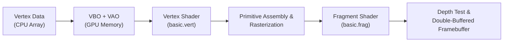

# Cơ sở lý thuyết Computer Graphics — RoomCraft 3D

Tài liệu này tổng hợp các khái niệm và thuật toán Computer Graphics được triển khai trong mã nguồn, phục vụ quá trình học tập và bảo vệ đồ án.

## 1. Milestone M0 — Nền tảng Modern OpenGL 3.3 Core Pipeline

### 1.1. Core Profile vs. Compatibility/Legacy OpenGL
- **Legacy OpenGL (OpenGL 1.x / 2.x)** dùng *fixed-function pipeline* (`glBegin`/`glEnd`, `glMatrixMode`, `glLightfv`), gửi từng đỉnh từ CPU sang GPU theo từng lệnh gọi hàm nên kém hiệu quả và không lập trình được quá trình xử lý đỉnh/mảnh.
- **Modern OpenGL 3.3 Core Profile** loại bỏ hoàn toàn fixed-function pipeline. Mọi dữ liệu hình học phải được nạp vào bộ đệm GPU (**VBO**) mô tả bởi **VAO**, và mọi phép biến đổi đỉnh/tô màu mảnh được lập trình bằng **GLSL Shader**.

### 1.2. VBO, VAO và bố cục thuộc tính đỉnh (Vertex Layout)
- **VBO (Vertex Buffer Object)**: Vùng nhớ liên tục trên GPU lưu mảng dữ liệu đỉnh (trong M0: mỗi đỉnh gồm 6 số thực `float`: `x, y, z` cho vị trí và `r, g, b` cho màu sắc, kích thước stride = `6 * sizeof(float) = 24 byte`).
- **VAO (Vertex Array Object)**: Đối tượng trạng thái lưu cách GPU giải mã VBO (thuộc tính `location = 0` đọc 3 float tại offset `0`; thuộc tính `location = 1` đọc 3 float tại offset `3 * sizeof(float)`).

### 1.3. Luồng xử lý Graphics Pipeline trong M0

1. **Vertex Shader (`assets/shaders/basic.vert`)**: Nhận `aPos` (tọa độ NDC trong khoảng $[-1, 1]$) và `aColor`, xuất `gl_Position = vec4(aPos, 1.0)` và truyền `vColor` sang giai đoạn sau.
2. **Rasterization**: Khối phần cứng tạo tập các mảnh (fragments) phủ tam giác và thực hiện **nội suy tọa độ trọng tâm (barycentric interpolation)** giá trị `vColor` từ 3 đỉnh.
3. **Fragment Shader (`assets/shaders/basic.frag`)**: Nhận `vColor` đã nội suy và xuất màu cuối `FragColor = vec4(vColor, 1.0)`.
4. **Viewport Transform**: Hàm `glViewport(0, 0, width, height)` ánh xạ tọa độ NDC $[-1, 1] \times [-1, 1]$ sang tọa độ pixel màn hình $[0, \text{width}] \times [0, \text{height}]$ mỗi khi cửa sổ thay đổi kích thước.

### 1.4. Kết hợp FreeGLUT với Dear ImGui trên OpenGL 3.3 Core
- Ví dụ mặc định của Dear ImGui cho GLUT dùng `imgui_impl_opengl2` (fixed-function), **không hoạt động** trong OpenGL 3.3 Core Profile.
- RoomCraft 3D kết hợp **`imgui_impl_glut`** (nhận sự kiện bàn phím, chuột, cuộn và resize từ FreeGLUT) với **`imgui_impl_opengl3`** (khởi tạo bằng `#version 330 core`, tự tạo VAO/VBO/shader GLSL 330 để vẽ UI overlay).

## 2. Các phần lý thuyết cho milestone tiếp theo (sẽ bổ sung khi triển khai)
- **M1**: Hệ tọa độ không gian (Local → World → View → Clip → NDC → Screen) và ma trận $P_{\text{clip}} = P \cdot V \cdot M \cdot P_{\text{local}}$.
- **M2**: Sinh hình học tham số, đường cong & mặt cong Bézier bậc 3, mặt tròn xoay (Surface of Revolution) và tính vector pháp tuyến.
- **M5**: Camera Orbit/Pan/Zoom, phép chiếu phối cảnh & trực giao, Ray Casting và Ray-AABB Intersection (Slab Method).
- **M7**: Mô hình chiếu sáng Phong / Blinn-Phong và Normal Matrix $(M^{-1})^T$.
- **M8**: Phát hiện va chạm AABB 3D với ngưỡng epsilon.
