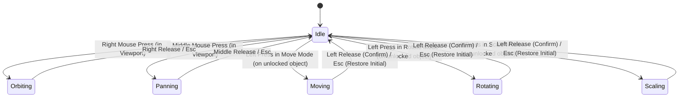

# Hướng dẫn Tương tác 3D & Máy trạng thái — RoomCraft 3D (Interaction Guide — M5 & M6)

Tài liệu này mô tả bảng điều khiển chuột/bàn phím, **3-Axis Move Gizmo (M6)**, toán học kéo thả giữ cao độ Y, Grid/Angle Snapping và **Interaction State Machine**.

---

## 1. Bảng phím tắt & thao tác Chuột trong 3D Viewport

| Thao tác | Chức năng |
|---|---|
| **Click chuột trái** | Chọn vật thể trong 3D Viewport (nhấn khoảng trống để bỏ chọn) |
| **Kéo tay cầm 3-Axis Move Gizmo (Đỏ X / Xanh lá Y / Xanh dương Z)** | Di chuyển chính xác theo từng trục X, Y hoặc Z (ưu tiên hit-test hơn vật phía sau; kích thước màn hình ổn định) |
| **Kéo chuột trái (`Move`)** | Kéo di chuyển vật thể trên mặt phẳng ngang giữ nguyên cao độ `Y` |
| **Kéo chuột trái (`Rotate`)** | Xoay vật thể quanh trục `Y` (tự động snap góc `15°` khi bật `Snap`) |
| **Kéo chuột trái (`Scale`)** | Phóng to / thu nhỏ đồng nhất an toàn trong `[0.1, 10.0]` |
| **Kéo chuột phải** | **Orbit Camera** xoay quanh mục tiêu |
| **Kéo chuột giữa** | **Pan Camera** dịch chuyển song song góc nhìn |
| **Con lăn chuột** | **Zoom Camera** (khoảng cách ở Perspective / tỷ lệ khung ở Orthographic) |
| **`Q` / `G` / `R` / `S`** | Chuyển chế độ `Select` / `Move` / `Rotate` / `Scale` |
| **`X` / `Y` / `Z`** | Bật/tắt giới hạn trục tương ứng khi đang ở chế độ `Move` / `Rotate` / `Scale` |
| **`F`** / **`Home`** | `Focus Selected` (căn vào vật thể chọn) / `Fit Room` (căn toàn phòng) |
| **`1` / `2` / `3`** | `Top View (Ortho)` / `Perspective 3D` / `Isometric` |
| **`Delete`** / **`Ctrl + D`** | Xóa vật thể đang chọn (trừ vật khóa) / Nhân bản vật thể đang chọn |
| **`Esc`** | Hủy tương tác đang diễn ra & **khôi phục Transform ban đầu** (không đóng app) |

> **An toàn nhập liệu GUI**: Toàn bộ phím tắt tự động bị vô hiệu hóa khi bạn đang gõ chữ trong ô tìm kiếm, ô đổi tên hoặc hộp thoại xác nhận (`WantTextInput` / Popup).

---

## 2. Kéo thả trên mặt phẳng ngang (`Ray–Plane Intersection`) & `grabOffset`

Khi bắt đầu kéo một đối tượng ở độ cao ban đầu $y_0 = \text{initialTransform.position.y}$:
1. Tạo mặt phẳng ngang $y = y_0$ với pháp tuyến $\mathbf{N} = (0, 1, 0)$.
2. Tính giao điểm tia chuột ban đầu:
   $$t = \frac{(P_0 - \mathbf{O})\cdot \mathbf{N}}{\mathbf{D}\cdot \mathbf{N}}, \qquad \mathbf{H}_0 = \mathbf{O} + t\mathbf{D}$$
3. Lưu **`grabOffset`** $= \mathbf{P}_{\text{initial}} - \mathbf{H}_0$ (với thành phần $y = 0$) để vật thể **không bị giật nhảy** về tâm con trỏ khi mới nhấn giữ chuột.
4. Khi chuột di chuyển, tính giao điểm mới $\mathbf{H}$ trên cùng mặt phẳng $y = y_0$:
   $$\mathbf{P}_{\text{target}} = (H_x + \text{grabOffset}_x,\; y_0,\; H_z + \text{grabOffset}_z)$$
   Nhờ vậy `Computer Setup`, `Desk Lamp` (`y = 0.75 m`) và `Ceramic Vase` (`y = 0.45 m`) giữ nguyên cao độ trên mặt bàn khi kéo sang vị trí khác.
5. Nếu bật **Grid Snapping**, tọa độ $(X, Z)$ được làm tròn trực tiếp từ $\mathbf{P}_{\text{target}}$ chưa snap theo `RoomSettings::gridSpacing` (không cộng dồn sai số tích lũy qua từng khung hình).

---

## 3. Máy trạng thái tương tác (Interaction State Machine)

Chỉ cho phép **duy nhất một tương tác** hoạt động tại một thời điểm ([InteractionState.hpp](file:///d:/CG/include/roomcraft/systems/InteractionState.hpp)):

