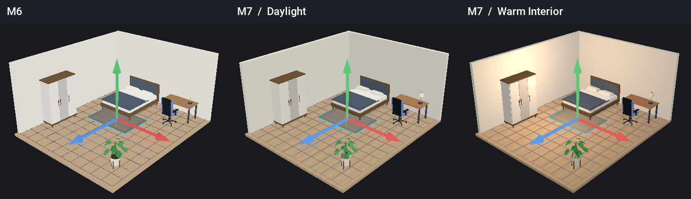
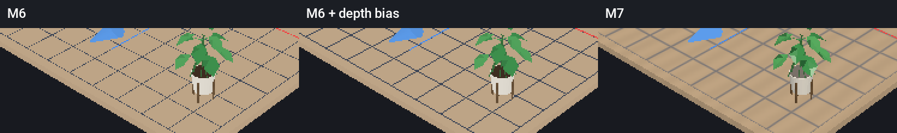

# Báo cáo bàn giao RoomCraft 3D M7 · v0.7.0

**IMPLEMENTED, chờ nghiệm thu thủ công và thị giác.** Trên Windows x64 và Intel UHD, baseline M6 đạt 13/13 CTest, M7 đạt 14/14. Với 30 vật thể, editor M7 mất trung bình 6,08 ms/khung, p95 7,36 ms. M6 giữ CONDITIONAL PASS. M8 và M9 ở TODO.

## Audit và build

Baseline là HEAD `e86132a`, working tree ban đầu sạch. Room sinh mặt trên sàn ở Y=0, mesh lưới GL_LINES ở Y=0,002 m. FBO M6 có texture RGBA8 đơn mẫu và depth/stencil 24/8. Mesh shader M6 dùng pháp tuyến local và hệ số tương phản cố định. Assimp đã nạp Kd, Ks, Ns, map_Kd. SceneObject chia sẻ GpuAsset qua AssetManager. Thumbnail cache trước đây so địa chỉ thô của asset. Không thấy PROJECT_CONTEXT.md, SESSION_HANDOFF.md và DECISION_LOG.md trong baseline.

Configure Debug thành công. Lần link đầu thoát 1 vì Windows khóa RoomCraft3D.exe của PID 22140. Dùng cùng preset và toolchain, chuyển output sang m7-bin. Lần CTest đầu ở vị trí mới có một lỗi M3 do thiếu fixtures tương đối, sau khi chép fixtures nguyên bản đã chạy lại đủ 13/13. Bản thứ hai của mã M6 phục vụ đo dùng cùng GLAD đã sinh từ build baseline, do lần tái sinh GLAD từ cache nguồn báo lỗi đọc XML. Phiên kiểm thử sử dụng dependency cache hiện có.

| Lệnh hoặc bước thực thi | Kết quả |
|---|---|
| `cmake --preset mingw-x64-debug` | 0, cấu hình Debug |
| `cmake --preset mingw-x64-debug "-DCMAKE_RUNTIME_OUTPUT_DIRECTORY=$pwd/build/mingw-x64-debug/m7-bin" -DFETCHCONTENT_UPDATES_DISCONNECTED=ON` | 0, chuyển output cục bộ |
| `cmake --build --preset mingw-x64-debug` tại output riêng | 0 cho baseline và M7, không thấy compiler warning của project. CMake báo hai deprecation từ GLM |
| `ctest --test-dir build/mingw-x64-debug --output-on-failure` trên M6 | 0, 13/13 trong 4,77 s |
| `ctest --test-dir build/mingw-x64-debug --output-on-failure -V` trên M7 | 0, 14/14 trong 6,63 s |
| `RoomCraft3D.exe --m4-benchmark` tại từng output | 0 ở cả M6 và M7, OpenGL errors NONE |
| MSVC/vcpkg, Release, GPU khác | NOT RUN |

[CTest baseline M6](evidence/m7/baseline-ctest.txt) · [CTest chi tiết M7](evidence/m7/m7-ctest.txt)

## Triển khai và các tệp thay đổi

| Thành phần | Đường dẫn chính | Quyết định |
|---|---|---|
| Blinn–Phong, gamma | `assets/shaders/mesh.vert`, `mesh.frag`, `graphics/Shader`, `Renderer`, `Texture` | Vị trí và normal ở world space, inverse-transpose trên CPU, chặn phản xạ mặt khuất, decode texture bằng phần cứng, encode một lần ở đầu ra |
| Nguồn sáng và preset | `include/roomcraft/graphics/Lighting.hpp`, `src/graphics/SceneRenderer.cpp` | Một ambient, một directional, một point, tính attenuation theo mét. Gizmo và overlays có màu độc lập với đèn |
| Vật liệu | `include/roomcraft/assets/AssetData.hpp`, `graphics/Material.hpp`, `src/core/Application.cpp`, `ThumbnailRenderer` | Sáu mô hình thủ tục ánh xạ vật liệu theo phần. Tám OBJ giữ nguyên UV, Ks, Ns, diffuse map. Thumbnail dùng Neutral Studio, weak_ptr xác định thế hệ asset |
| Sàn, tường, lưới | `mesh.frag`, `SceneRenderer.cpp` | Sơn mờ, màu gỗ và vân nhẹ theo mét. Lưới sàn tính theo kích thước mỗi pixel. Đường lưới wireframe giữ đường vẽ riêng |
| Editor | `include/roomcraft/editor/RoomEditor.hpp`, `src/editor/RoomEditor.cpp` | Nhóm Lighting Settings trong tab Room Settings, Material Inspector hiển thị vật liệu và chỉnh độ bóng theo instance (`SceneObject::shininessScale`), bốn preset, Custom, Reset và số mẫu MSAA thực tế |
| Render target | `include/roomcraft/graphics/Framebuffer.hpp`, `src/graphics/Framebuffer.cpp` | Cấp phát khi đổi kích thước hoặc số mẫu, kiểm tra completeness, resolve sang texture một mẫu, move-only, giải phóng trước khi hủy context |
| Build, test, đo | `CMakeLists.txt`, `src/main.cpp`, `src/core/Application.cpp`, `vcpkg.json`, `tests/LightingTests.cpp`, `tests/unit/AssetCatalogTests.cpp` | Phiên bản 0.7.0, test GPU độc lập, kiểm tra Ks/Ns, GPU timer và đo editor qua swap. Shader thay đổi sẽ kích hoạt đồng bộ lại assets với Ninja |
| Đóng gói và tài liệu | `.gitignore`, README, CHANGELOG, tài liệu thiết kế, test, tiến độ và bàn giao | Cho phép Git thấy 8 Wavefront OBJ và 5 fixture OBJ sẵn có, trước đây bị lọc cùng đuôi object file biên dịch. Nội dung mô hình không tái sinh |

Phương trình và giá trị preset ở [Lighting System](LIGHTING_SYSTEM.md). Ví dụ vật liệu ở [Material System](MATERIAL_SYSTEM.md). Đường đi của màu, depth và resolve ở [Rendering Pipeline](RENDERING_PIPELINE.md). Kiến trúc tiếp tục dùng OpenGL 3.3 Core, FreeGLUT, GLAD và ImGui OpenGL3.

## Thí nghiệm lưới

Chụp Modern Bedroom ở cùng camera và cửa sổ 1280×720. Trong bản M6 đối chứng riêng, chỉ dịch clip depth của line shader bằng `gl_Position.z -= 0.00012 * gl_Position.w`. Do XY giữ nguyên, raster footprint của đường vẫn giữ nguyên. Trong vùng sàn trống 7.623 pixel, 181 pixel đổi từ màu sàn (189,164,134) sang màu lưới (64,72,88). Phép thử xác nhận depth rejection góp phần làm đứt nét dù lưới đã nhô lên 2 mm. Đường một mẫu còn thể hiện bậc thang ở góc xiên. Kết quả này giới hạn ở camera đã đo.

M7 tính khoảng cách tới vạch lưới trong fragment của sàn, dùng fwidth để lọc độ phủ. Cơ chế này bỏ lượt depth test cạnh tranh giữa đường và mặt sàn. Chi phí draw call ở cảnh benchmark giảm một lượt. Top và Isometric được chụp trên runtime. Picking và snap tiếp tục dùng hệ tọa độ cũ.

## Benchmark đối chứng

Bản M6 đối chứng lấy từ HEAD, bổ sung đúng đoạn benchmark của M7 và cùng kích thước cửa sổ. Hai lần chạy kế tiếp trên Intel UHD, driver 32.0.101.7088, OpenGL 3.3 Core, WinLibs MinGW x64 Debug. Cùng ScenePresets::buildBenchmarkScene(30), camera từ (8,7,9), auto-fit hệ số 1,18, FBO 1280×720, Off/1 mẫu, shadow tắt. Cửa sổ editor 1878×815. Một phiên editor của người dùng vẫn mở trong cả hai lần.

| Chỉ số thực đo | M6 | M7 |
|---|---:|---:|
| CPU gửi lệnh, ms/khung | 2,369 | 2,431 |
| GPU bằng GL_TIME_ELAPSED, ms/khung | 0,228 | 0,387 |
| Off-screen theo lô, ms/khung | 3,020 | 2,649 |
| Editor gồm scene, ImGui, swap và chờ GPU, ms/khung | 4,780 | 6,078 |
| Editor p95, ms | 5,393 | 7,363 |
| Draw call cảnh / tam giác mỗi khung | 417 / 24.876 | 416 / 24.876 |

Off-screen chạy 5 khung warm-up rồi đo 30 khung với glFinish cuối lô. Phép đo CPU/GPU tách riêng từng khung bằng timer query, CPU có thể chờ driver. Cột editor đo 60 lần gọi renderInteractiveFrame sau 5 khung warm-up, glFinish sau swap, gồm cả dựng giao diện. VSync theo mặc định driver, giá trị swap interval thực tế chưa truy vấn. Phép đo không bao gồm độ trễ thiết bị nhập và thời gian người dùng chờ sự kiện. Ba phép đo có điểm đồng bộ khác nhau, nên không cộng các hàng.

Trung bình editor M7 tương đương khoảng 165 khung/giây trong cấu hình này. Cặp đo cuối nằm trong ngân sách 16,67 ms cho 60 Hz. Ở cặp đo trước khi thêm thanh độ bóng theo instance, editor M6 đạt 6,65 ms trung bình và 8,38 ms p95, còn M7 đạt 9,49 ms và 18,15 ms p95. Độ dao động giữa các lần chạy cần được tính đến khi cân nhắc thêm shadow pass. Mặc định MSAA Off để tiết kiệm băng thông và bộ nhớ viewport. P2 Shadow Mapping ở TODO. Một depth pass thứ hai sẽ tăng draw calls theo số caster và cần đo thêm p95, bias, acne, peter-panning cùng độ phân giải trước khi bật mặc định.

[Lần cuối M6](evidence/m7/m6-benchmark.txt) · [Lần cuối M7](evidence/m7/m7-benchmark.txt) · [Lần trước M6](evidence/m7/m6-benchmark-initial.txt) · [Lần trước M7](evidence/m7/m7-benchmark-initial.txt)

## Ánh xạ yêu cầu sang bằng chứng

| Test | Bằng chứng và trạng thái |
|---|---|
| T01 | VERIFIED. 13 bộ M0–M6 đạt cả trước và sau thay đổi |
| T02 | VERIFIED. M7_LightingGpu biên dịch, link cặp GLSL thật và render quad |
| T03–T06 | VERIFIED. Pixel khi thay ambient, directional đỏ, point xanh, khoảng cách 1/4 m. Kiểm tra chặn specular mặt khuất và độ rộng highlight theo Ns |
| T07 | VERIFIED. GPU kiểm tra biến đổi pháp tuyến khi scale (3,1,1) và scale suy biến |
| T08–T09 | VERIFIED. M3_AssetUnitTests so độ bóng của vải/gỗ/gốm/kim loại và đối chiếu Ks=0,5, Ns=490 của ComputerAluminum qua submesh. M4_SceneUnitTests kiểm tra chỉnh độ bóng độc lập giữa các instance. Kiểm 6 procedural và 8 imported |
| T10 | VERIFIED. M3_IntegrationSmokeTest đọc lại fixture texture bất đối xứng và fallback checker khi thiếu texture |
| T11 | VERIFIED. Mid-gray round trip, màu nền nhân texture trong linear space, half irradiance cho khoảng 92/255 |
| T12, T19 | VERIFIED trên Intel UHD. Driver cấp 1/2/4 mẫu, pixel sau resolve đúng trong sai số, resize 65→97 giữ màu, 0 lỗi GL. M1 kiểm tra move và resize về 0. Nhánh driver giới hạn dưới 2 mẫu chưa gặp |
| T13 | VERIFIED qua thao tác tự động trên cửa sổ thật. Điều chỉnh ambient, hướng, cường độ/màu và bật/tắt hai đèn, vị trí, ba hệ số attenuation, reset. Đếm pixel thay đổi bên trong phòng, loại UI ra khỏi vùng so sánh. [Kết quả từng control](evidence/m7/ui-controls.txt) |
| T14 | VERIFIED. Bốn preset cho bốn màu phân biệt theo cặp, reset cho cùng kết quả Daylight. Đã chọn Warm Interior qua combo thật |
| T15–T16 | VERIFIED. M6 smoke tạo 14/14 thumbnail có pixel, tái dùng cache, reload/invalidation và kiểm tra trạng thái GL. M3 smoke kiểm tra reload lỗi vẫn giữ asset cũ |
| T17–T18 | VERIFIED tự động qua M5 interaction, M5/M6 integration và M6 UI/gizmo. Nghiệm thu thao tác người dùng vẫn mở |
| T20 | VERIFIED ở các cấu hình mẫu. Pixel tại giao lưới đổi khi bật; có ảnh Perspective, Top và Isometric. Duyệt khi orbit liên tục còn mở |
| T21 | VERIFIED. Đã đo CPU/GPU/off-screen/editor, p95, draw calls, triangles và ghi điều kiện ở bảng trên |
| T22 | Đã thu ảnh thật và kiểm tra nội dung. Phê duyệt thị giác cuối cùng NOT VERIFIED |
| T23 | NOT RUN. P2 shadow hoãn, chưa có depth pass hoặc ảnh so sánh shadow |

## Ảnh runtime và checklist nghiệm thu

PNG nguyên bản từ vùng client của cửa sổ đang chạy. Hình ghép đầu báo cáo cắt cùng tọa độ từ ba ảnh phòng gốc.

- [Modern Bedroom M6](evidence/m7/m6-bedroom.png) · [Daylight](evidence/m7/daylight.png) · [Warm Interior](evidence/m7/warm-interior.png)
- [Gaming Workspace](evidence/m7/gaming-workspace.png) · [Minimalist Living Room](evidence/m7/minimalist-living-room.png)
- [Lighting Settings](evidence/m7/lighting-panel.png) · [Material Inspector](evidence/m7/material-inspector.png)
- [Grid Top](evidence/m7/grid-top.png) · [Grid Isometric](evidence/m7/grid-isometric.png)
- [MSAA Off](evidence/m7/msaa-off.png) · [MSAA 4x](evidence/m7/msaa-4x.png)

Người duyệt đánh dấu sau khi trải nghiệm trên ứng dụng M7.

- [ ] Chuyển Grid/List, đổi UI Scale 100/125/150%, kéo splitter, xác nhận Inspector còn dễ dùng. Đây cũng là nợ nghiệm thu M6.
- [ ] Pick, kéo gizmo, hủy bằng Esc, resize viewport và lặp lại. So đối tượng được chọn và vị trí trục với con trỏ.
- [ ] Đổi bốn preset, xoay quanh phòng, kiểm tra highlight trên kim loại/gốm, độ dịu của vải, texture gỗ và tường gần đèn điểm. Xác nhận vùng sáng ở Warm Interior.
- [ ] So grid ở 3D/Top/Iso khi zoom và orbit, kiểm tra snap khi lưới bật/tắt. So đường biên cùng góc nhìn ở Off/2x/4x.
- [ ] Duyệt ba phòng và ảnh gốc cùng benchmark trước khi ký visual acceptance.

**Quyết định cổng:** build, runtime, hồi quy và kiểm thử GPU đạt. M7 giữ IMPLEMENTED tới khi người dùng chấp thuận checklist; M6 giữ CONDITIONAL PASS. Nợ kỹ thuật gồm p95, thẩm định các GPU khác, và shadow pass tùy chọn. Vị trí bản chạy, cách khôi phục output và hướng dẫn duyệt nằm ở [Session Handoff](SESSION_HANDOFF.md) và [Build Guide](BUILD_GUIDE.md).

## Kiểm toán kỹ thuật cuối M7

Từng hàng dưới đây đối chiếu đường thực thi với assertion và log tương ứng. Các kiểm tra GPU dùng Intel UHD. M6 giữ CONDITIONAL PASS. M7 giữ IMPLEMENTED trong khi chờ 24 mục nghiệm thu thủ công và duyệt thị giác của người dùng. Shadow Mapping DEFERRED vì thêm lượt dựng depth từ đèn sẽ tăng chi phí và cần xác minh frame time cùng shadow bias.

| Yêu cầu | Mã thực thi | Bằng chứng và phạm vi |
|---|---|---|
| Blinn–Phong | [mesh.frag](../assets/shaders/mesh.frag), `illuminate` | `M7_LightingGpu` đo lobe khi đổi Ns và kiểm tra mặt quay lưng không nhận specular. Công thức dùng half-vector H = normalize(L+V). |
| Ambient | [mesh.frag](../assets/shaders/mesh.frag), `main` | Tắt cả hai đèn trực tiếp. Ambient 1,0 cho khoảng 128/255 với nền sRGB 0,5. Ambient 0,5 cho 92/255. |
| Directional | [Renderer.cpp](../src/graphics/Renderer.cpp), `applyLighting` và `mesh.frag` | `directional red` xác minh kênh màu khi hướng tia là −Z. Đổi dấu hướng kiểm tra mặt khuất. Shader lấy L từ hướng đèn và không dùng vị trí fragment cho nguồn này. |
| Point và attenuation | [mesh.frag](../assets/shaders/mesh.frag), `delta`, `divisor` | `point light attenuation` đọc kênh xanh ở khoảng cách 1 m và 4 m. Ánh sáng chia cho max(kc + kl·d + kq·d², 0,001). Log control M7 ghi phản ứng khi đổi từng hệ số. |
| Normal matrix | [Renderer.cpp](../src/graphics/Renderer.cpp), `drawMeshTextured` và [mesh.vert](../assets/shaders/mesh.vert) | `inverse transpose` dùng pháp tuyến nghiêng và scale (3,1,1) rồi so chênh lệch pixel. `singular model` xác minh scale suy biến không tạo thành phần sáng trực tiếp. |
| Vật liệu thống nhất | [AssetData.hpp](../include/roomcraft/assets/AssetData.hpp), [ModelLoader.cpp](../src/assets/ModelLoader.cpp), [SceneRenderer.cpp](../src/graphics/SceneRenderer.cpp) | M3 Asset Unit Tests so chất liệu thủ tục và đọc Ks/Ns của ComputerAluminum. M3 smoke kiểm tra UV, nhiều vật liệu và texture dự phòng. M6 smoke dựng 14/14 thumbnail. |
| Shininess theo instance | [SceneObject.hpp](../include/roomcraft/scene/SceneObject.hpp), `shininessScale`, [RoomEditor.cpp](../src/editor/RoomEditor.cpp) và `SceneRenderer.cpp` | M4 Scene Unit Tests xác minh thay hệ số riêng giữa các ghế dùng chung asset. GPU test đo độ rộng highlight theo Ns. Chất lượng highlight trên nội thất thật chờ duyệt. |
| Gamma và mã hóa kép | [Texture.cpp](../src/graphics/Texture.cpp), [mesh.frag](../assets/shaders/mesh.frag), [Framebuffer.cpp](../src/graphics/Framebuffer.cpp) | sRGB texture giải mã phần cứng. Shader mã hóa đầu ra một lần. Đích RGBA8 và ImGui lấy mẫu bình thường. Kiểm thử đọc pixel cho round trip, nền nhân texture và giảm irradiance. Mã nguồn không bật GL_FRAMEBUFFER_SRGB. Kiểm thử đọc FBO, còn kết quả sau compositor được đối chiếu qua ảnh thực tế. |
| MSAA và resolve | [Framebuffer.cpp](../src/graphics/Framebuffer.cpp), `bindMultisampled` và `resolveMultisampled`, [RoomEditor.cpp](../src/editor/RoomEditor.cpp) | GPU test kiểm tra color resolve và số mẫu thật 1/2/4 sau chuyển cấu hình, rồi resize 65→97. Benchmark chạy qua viewport editor và xác nhận số mẫu mỗi lượt. Nhánh fallback phần cứng thấp hơn chưa gặp. |
| Grid | [mesh.frag](../assets/shaders/mesh.frag), `fwidth`, [SceneRenderer.cpp](../src/graphics/SceneRenderer.cpp) | GPU test đọc giao lưới ở world origin. Ảnh đối chứng trước/sau depth bias và ảnh 3D/Top/Iso lưu trong bộ bằng chứng. Orbit/zoom liên tục chờ người dùng duyệt. |
| Lighting presets | [Lighting.hpp](../include/roomcraft/graphics/Lighting.hpp), [RoomEditor.cpp](../src/editor/RoomEditor.cpp) | GPU test cho bốn kết quả pixel phân biệt theo cặp và reset về Daylight. Combo được đối chiếu trong ảnh cửa sổ thật. |
| Thumbnail invalidation | [ThumbnailRenderer.cpp](../src/graphics/ThumbnailRenderer.cpp), `getOrCreateThumbnail`, [AssetManager.cpp](../src/assets/AssetManager.cpp) | So đối tượng sống qua weak_ptr và kích thước. M6 TC-M6-17/18/34 kiểm tra cache hit, reload và khôi phục nhóm GL state dùng trong test. M3 smoke xác minh reload lỗi giữ asset trước đó. |
| Vòng đời GPU | [Framebuffer.cpp](../src/graphics/Framebuffer.cpp), `releaseMultisample`, `destroy`, [Application.cpp](../src/core/Application.cpp), `shutdownGraphics` | M1 smoke kiểm move và resize về 0. M7 GPU kiểm chuyển mẫu, resolve, resize và glGetError. M6 TC-M6-35/36 kiểm cleanup thumbnail. Đọc mã xác nhận thứ tự giải phóng trước khi context bị hủy. Chưa đo rò bộ nhớ dài hạn bằng profiler. |
| Camera, picking, gizmo | [CameraController.cpp](../src/systems/CameraController.cpp), [PickingSystem.cpp](../src/systems/PickingSystem.cpp), [TransformGizmo.cpp](../src/systems/TransformGizmo.cpp) | M5 Interaction Unit/Integration và M6 Editor UI/Integration kiểm các đường camera, ray casting, resize/DPI, constrain, Esc và render gizmo. Checklist chuột/phím thật của M6 và M7 còn mở. |

Bằng chứng kiểm thử nằm trong [log CTest cuối](evidence/m7/qa-ctest.txt) và [log thao tác control M7](evidence/m7/ui-controls.txt).

### Frame time Off, 2× và 4×

Bản Debug trên Intel UHD, cùng 30 vật thể, camera và viewport 1280×720 như báo cáo trước. Mỗi hàng đo 300 khung sau 60 khung warm-up. Ba vòng xoay thứ tự để mỗi mức MSAA đứng đầu, giữa và cuối một lần. Phép đo lấy thời gian gọi renderInteractiveFrame qua swap rồi chờ glFinish. p95/p99 lấy theo nearest rank. WGL báo swap interval 1 ở phiên này, compositor và tải máy vẫn ảnh hưởng thời gian ghi nhận. Một cửa sổ M7 dùng để kiểm tra ảnh đã mở trong cùng phiên đo. Đơn vị là ms/khung.

| Vòng | MSAA và số mẫu thực | Trung bình | Trung vị | p95 | p99 |
|---:|---|---:|---:|---:|---:|
| 1 | Off (1) | 23,36 | 17,81 | 49,84 | 86,75 |
| 1 | 2× | 19,53 | 16,89 | 33,23 | 64,92 |
| 1 | 4× | 18,09 | 16,77 | 31,26 | 38,24 |
| 2 | 2× | 11,49 | 11,03 | 17,22 | 17,97 |
| 2 | 4× | 9,49 | 8,91 | 15,34 | 20,05 |
| 2 | Off (1) | 8,71 | 9,10 | 12,58 | 16,06 |
| 3 | 4× | 8,71 | 9,09 | 12,33 | 15,20 |
| 3 | Off (1) | 8,66 | 9,02 | 12,57 | 16,51 |
| 3 | 2× | 8,43 | 8,95 | 11,71 | 12,42 |

Mọi lượt vòng 1 vượt ngân sách 16,67 ms ở p95. Vòng 3 nằm trong ngân sách ở cả ba cấu hình. Off có p95 12,57–49,84 ms trong phiên QA. Thứ tự các mức MSAA theo p95 thay đổi giữa các vòng. Phiên đo này chưa cô lập được chi phí riêng của MSAA khỏi tải máy và cơ chế trình bày khung hình. Hai lần đo lịch sử 7,36/18,15 ms thiếu swap interval được truy vấn và dữ liệu nhiệt độ, xung GPU, tải nền. Vì vậy chưa xác định được nguyên nhân của chênh lệch lịch sử. Gate hiệu năng giữ CONDITIONAL PASS. Theo dõi cả đuôi phân phối thay vì lấy một lượt tốt nhất.

### Executable và hình ảnh

Sau khi M6 được đóng, chạy `cmake --preset mingw-x64-debug -U CMAKE_RUNTIME_OUTPUT_DIRECTORY` và build lại. Configure, build, CTest và benchmark đều thoát mã 0. CTest verbose xác nhận các smoke test gọi `build/mingw-x64-debug/RoomCraft3D.exe`. Bản đó in `v0.7.0` khi chạy `--help`. File trong m7-bin là bản cũ của lần QA trước và nằm ngoài đích build/CTest hiện hành.

Ảnh Daylight mới được chụp trên cửa sổ M7 trước khi thao tác Computer Use dừng. Dùng lại ảnh runtime đã chụp cho Warm Interior, Lighting Settings, Material Inspector, Gaming Workspace, Minimalist Living Room, Grid và MSAA Off/4× trong bộ bằng chứng ở trên. Ảnh Neutral Studio và Evening đang NOT RUN. Visual Acceptance và Manual Acceptance vẫn là NOT VERIFIED.

[Log đầy đủ chín lượt benchmark](evidence/m7/qa-bench.txt) · [CTest trên bản mặc định](evidence/m7/qa-ctest.txt) · [Daylight từ lượt QA](evidence/m7/qa-daylight.png)
