# Thuật toán Ray Casting & Object Picking — RoomCraft 3D (M5)

Tài liệu này mô tả chi tiết luồng chuyển tọa độ chuột 2D thành tia 3D (Screen-to-World Ray) và hệ thống chọn đối tượng 2 giai đoạn (**Ray–AABB Broad-phase** + **Möller–Trumbore Ray–Triangle Narrow-phase** + **Occlusion-Aware Walls**) tại **Milestone M5**.

---

## 1. Luồng chuyển đổi tọa độ (Screen → Viewport-Local → NDC → World Ray)

```mermaid
flowchart LR
    M["Tọa độ chuột cửa sổ\n(screenX, screenY)"] --> VP["ViewportRect cục bộ\n(local = mouse - rectMin)\nHỗ trợ chênh lệch DPI/FBO"]
    VP --> NDC["OpenGL NDC [-1, +1]\nndcX = 2u - 1\nndcY = 1 - 2v (lật trục Y)"]
    NDC --> INV["Giải chiếu bằng (P * V)^-1\nNear (ndcX, ndcY, -1)\nFar  (ndcX, ndcY, +1)"]
    INV --> RAY["World Ray R(t) = O + tD\nO = nearWorld\nD = normalize(far - near)"]
    RAY --> AABB["Broad-phase:\nRay–AABB (Slab Method)\n+ Wall Occlusion"]
    AABB --> TRI["Narrow-phase:\nRay–Triangle (Möller–Trumbore)"]
    TRI --> SEL["Nearest Valid ObjectId\n-> SelectionState"]
```



### Khác biệt giữa Phối cảnh (Perspective) và Trực giao (Orthographic)
- **Perspective**: Các tia xuất phát hội tụ về gần mắt camera và có hướng $\mathbf{D}$ tỏa ra khác nhau theo góc nhìn.
- **Orthographic**: Mọi tia có **hướng $\mathbf{D}$ song song nhau**, nhưng **điểm xuất phát $\mathbf{O}$ (trên mặt phẳng Near)** thay đổi tùy vị trí con trỏ chuột.
- Bằng cách giải chiếu đồng thời cả `nearClip = (ndcX, ndcY, -1, 1)` và `farClip = (ndcX, ndcY, +1, 1)` qua $(P \cdot V)^{-1}$ rồi chia thuần nhất cho $w$, hàm `Ray::screenToWorldRay()` ([Ray.hpp](file:///d:/CG/include/roomcraft/math/Ray.hpp)) xử lý **thống nhất và chính xác cho cả hai phép chiếu** mà không giả định gốc tia luôn là `camera.position`.

---

## 2. Broad-Phase: Ray–AABB Intersection (Slab Method)

Kiểm tra giao giữa tia $R(t) = \mathbf{O} + t\mathbf{D}$ và hộp bao thế giới $[\mathbf{b}_{\min}, \mathbf{b}_{\max}]$ trên từng trục $i \in \{x, y, z\}$ ([Intersection.cpp](file:///d:/CG/src/math/Intersection.cpp)):

```text
tMin = -INF, tMax = +INF
for axis in {X, Y, Z}:
    if |D[axis]| < 1e-7:                      // Tia song song slab
        if O[axis] < min[axis] or O[axis] > max[axis]:
            return NO_HIT
    else:
        t1 = (min[axis] - O[axis]) / D[axis]
        t2 = (max[axis] - O[axis]) / D[axis]
        if t1 > t2: swap(t1, t2)
        tMin = max(tMin, t1)
        tMax = min(tMax, t2)
        if tMin > tMax: return NO_HIT
if tMax < 0: return NO_HIT                    // Hộp bao nằm phía sau tia
tHit = (tMin < 0) ? 0 : tMin                  // Nếu gốc tia nằm trong box -> tHit = 0
```

---

## 3. Narrow-Phase: Ray–Triangle Refinement (Möller–Trumbore)

Vì AABB là hộp bao xấp xỉ, tia đi qua khoảng trống dưới gầm bàn hoặc khung ghế vẫn giao với AABB. Sau khi qua vòng lọc Broad-phase, `PickingSystem::intersectAssetTriangles()` ([PickingSystem.cpp](file:///d:/CG/src/systems/PickingSystem.cpp)) duyệt từng sub-mesh với ma trận $M_{\text{world\_part}} = M_{\text{object}} \cdot M_{\text{asset\_part}}$ và kiểm tra từng tam giác $(v_0, v_1, v_2)$ bằng thuật toán **Möller–Trumbore**:

$$\mathbf{e}_1 = v_1 - v_0, \quad \mathbf{e}_2 = v_2 - v_0, \quad \mathbf{p} = \mathbf{D} \times \mathbf{e}_2, \quad \det = \mathbf{e}_1 \cdot \mathbf{p}$$
$$u = \frac{(\mathbf{O} - v_0)\cdot \mathbf{p}}{\det}, \qquad v = \frac{\mathbf{D} \cdot ((\mathbf{O} - v_0) \times \mathbf{e}_1)}{\det}, \qquad t = \frac{\mathbf{e}_2 \cdot ((\mathbf{O} - v_0) \times \mathbf{e}_1)}{\det}$$

Tam giác trúng tia khi $|\det| > \epsilon$, $u \ge 0$, $v \ge 0$, $u + v \le 1$ và $t \ge 0$.

---

## 4. Chính sách Che khuất Tường (Wall Occlusion) & Đối tượng Ẩn/Khóa

- **Wall Occlusion**: Trước khi chấm điểm ứng viên nội thất, `PickingSystem` tìm khoảng cách $t_{\text{wall}}$ gần nhất tới các bức tường và trần **đang hiển thị** theo `RoomSettings::is*WallVisible()`. Mọi món nội thất có $t_{\text{hit}} > t_{\text{wall}}$ bị loại bỏ (không chọn xuyên tường). Các bức tường đang ẩn trong chế độ `Cutaway View` hoặc `Manual` **không** chặn tia.
- **Hidden Objects**: Đối tượng có `visible == false` bị bỏ qua hoàn toàn.
- **Locked Objects**: Đối tượng có `locked == true` **vẫn được chọn** để xem thông tin và mở khóa trong Inspector, nhưng `TransformController` từ chối kéo/xoay/scale/xóa và hiển thị cảnh báo rõ ràng.
- **Click vào khoảng trống**: Xóa lựa chọn hiện tại (`SelectionState::clearSelection()`) ở chế độ `Select` và `Move`.
