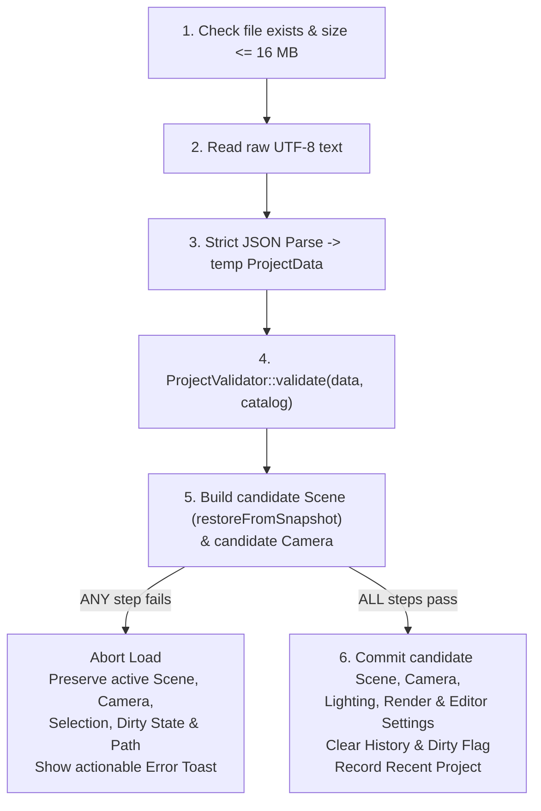

# Kiến trúc Lưu trữ Dự án, Giao dịch & Quản lý Trạng thái — RoomCraft 3D (Project Persistence — M8)

Tài liệu này mô tả luồng lưu tệp an toàn (Safe Atomic Saving), nạp tệp giao dịch (Transactional Loading), quản lý trạng thái chưa lưu (Dirty-State Workflow), hộp thoại tệp gốc Windows và hệ thống Undo/Redo (P2).

---

## 1. Quyết định về Thư viện JSON

Trước khi thêm phụ thuộc ngoài, đội phát triển đã đánh giá phương án nhúng `nlohmann/json` so với viết bộ phân tích/xuất JSON chặt chẽ nội bộ (`roomcraft::persistence::JsonValue`, `parseJson` tại [`Json.hpp`](../include/roomcraft/persistence/Json.hpp) và [`Json.cpp`](../src/persistence/Json.cpp)):

- **Lý do chọn bộ JSON RFC 8259 nội bộ (C++17 thuần)**:
  1. **An toàn build offline & không phình thời gian biên dịch**: Hoạt động ngay với `-DFETCHCONTENT_UPDATES_DISCONNECTED=ON` và không tăng thêm phụ thuộc mạng hay gói `vcpkg`.
  2. **Kiểm soát bảo mật & độ chính xác cao**: Tích hợp sẵn giới hạn dung lượng (`16 MB`), giới hạn độ sâu lồng nhau (`64`), phân biệt `int64`/`uint64`/`double`, từ chối ký tự thừa và các token không chuẩn như `NaN`/`Infinity`.
  3. **Không nâng cấp hay ảnh hưởng bất kỳ thư viện nền nào khác** (`FreeGLUT`, `GLAD`, `Dear ImGui`, `GLM`, `Assimp`, `stb_image`).

---

## 2. Nạp Dự án Giao dịch (Transactional Project Loading)

- **Bảo toàn tài nguyên GPU dùng chung**: Khi nạp tệp `.roomcraft`, `AssetManager` giữ nguyên các `GpuAsset` và texture đã cache trên GPU; không có lời gọi reload dư thừa cho các asset không đổi và không để lại con trỏ treo (`SelectionState` và `InteractionState` được đồng bộ lại sạch sẽ).
- **Chính sách thiếu Asset (`Missing Asset`)**: Nếu tệp tham chiếu một `assetId` không có trong `FurnitureCatalog`, quá trình nạp bị từ chối an toàn với thông báo nêu rõ `assetId` và tên đối tượng bị thiếu, giữ nguyên bản thiết kế hiện tại của người dùng.

---

## 3. Lưu Dự án An toàn trên Windows (Safe Atomic Saving)

Để đảm bảo không bao giờ làm hỏng tệp `.roomcraft` hợp lệ cũ ngay cả khi mất điện, thiếu quyền ghi hoặc tệp đích là `Read-Only`:

1. Gọi `ProjectValidator::validate()` xác thực toàn bộ dữ liệu trước khi chạm tới ổ đĩa.
2. Serialize toàn bộ nội dung JSON vào `std::string` trong bộ nhớ.
3. Kiểm tra thư mục đích tồn tại và tệp đích không phải thư mục / không đặt cờ `FILE_ATTRIBUTE_READONLY`.
4. Ghi toàn bộ byte vào tệp tạm duy nhất trong **cùng thư mục đích** (`<dest>.tmp.<seq>`), `flush()`, kiểm tra `ofstream::good()` và đối chiếu kích thước thực tế trên đĩa.
5. Gọi API Win32 **`MoveFileExW(temp, dest, MOVEFILE_REPLACE_EXISTING | MOVEFILE_WRITE_THROUGH)`** để thay thế tệp đích nguyên tử trên cùng ổ đĩa (hỗ trợ đầy đủ tên tệp **Unicode tiếng Việt** và **đường dẫn chứa khoảng trắng**).
6. Nếu bất kỳ bước nào thất bại: xóa tệp tạm, **giữ nguyên tệp đích cũ nguyên vẹn**, **không xóa cờ `dirty`**, và báo lỗi rõ ràng.

---

## 4. Quản lý Trạng thái Chưa lưu (`Dirty-State`) & Hộp thoại Tệp Windows

- **Hộp thoại tệp gốc Windows (`FileDialog`)**: Sử dụng Win32 `GetOpenFileNameW` / `GetSaveFileNameW` (`comdlg32`) với cờ `OFN_NOCHANGEDIR` (không làm thay đổi thư mục làm việc của ứng dụng) và `OFN_OVERWRITEPROMPT` (xác nhận ghi đè).
- **Chỉ báo thay đổi chưa lưu**: Khi có bất kỳ chỉnh sửa nào ảnh hưởng dữ liệu lưu (thêm/xóa/nhân bản/di chuyển/xoay/scale/đổi tên/ẩn-hiện/khóa/chỉnh vật liệu/đổi phòng/đổi ánh sáng/MSAA/chế độ va chạm), thanh menu góc phải và tiêu đề cửa sổ Windows hiển thị dấu **`*`** (`Modern Bedroom *`).
- **Luồng `Save` / `Discard` / `Cancel`**: Trước mọi hành động có thể làm mất dữ liệu (`New Project`, `Open Project`, `Recent Projects`, `Room Presets`, `Exit`, kể cả nhấn nút **`X`** trên cửa sổ Windows thông qua `WM_CLOSE` subclass trong `Window.cpp`):
  - **`Save`**: Chạy `saveProject()`. Nếu lưu thất bại hoặc người dùng bấm Cancel trên Save As → **hủy bỏ hành động phá hủy**, giữ nguyên dự án đang làm việc!
  - **`Discard`**: Bỏ thay đổi chưa lưu và tiếp tục hành động.
  - **`Cancel`**: Đóng hộp thoại và quay về làm việc bình thường.

---

## 5. Hệ thống Undo / Redo Giới hạn (P2 — `CommandHistory`)

- [`CommandHistory`](../include/roomcraft/systems/CommandHistory.hpp) lưu tối đa **64** snapshot gọn nhẹ (thuần CPU: `RoomSettings`, `std::vector<SceneObject>`, `nextObjectId`, `selectedObjectId`).
- **Gộp thao tác tương tác**: Một lần kéo chuột hoàn chỉnh (`Move`, `Rotate`, `Scale`) hoặc kéo thanh trượt Inspector chỉ tạo **đúng 1 mục lịch sử** sau khi nhả chuột (không ghi từng sự kiện di chuột).
- Mọi chỉnh sửa mới sẽ xóa ngăn xếp `Redo`; mở dự án mới hoặc tạo dự án mới sẽ làm sạch lịch sử; `nextObjectId` luôn giữ giá trị cao nhất để đảm bảo không bao giờ phát sinh trùng ID sau Undo/Redo.
