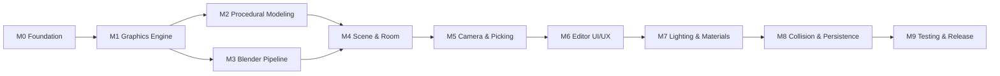

# Lộ trình phát triển — RoomCraft 3D (Roadmap)

Dự án được chia thành 10 milestone trong khoảng thời gian dự kiến 8 tuần.

| Milestone | Tên giai đoạn | Thời gian dự kiến | Phiên bản mục tiêu | Trạng thái |
|---|---|---|---|---|
| **M0** | Project Foundation | Tuần 1 | `v0.0.1` | VERIFIED (Auto 7/7 PASS; Manual GUI pending) |
| **M1** | Core Graphics Engine | Tuần 1–2 | `v0.1.0` | VERIFIED (Auto 16/16 PASS; Manual GUI pending) |
| **M2** | Procedural Geometry & Modeling | Tuần 2–3 | `v0.2.0` | VERIFIED (Auto 23/23 PASS; Manual GUI pending) |
| **M3** | Blender Asset Pipeline | Tuần 3–4 | `v0.3.0` | VERIFIED (Auto 27/27 PASS; Manual GUI pending) |
| **M4** | Scene Management & Room Editor | Tuần 4–5 | `v0.4.0` | VERIFIED (Auto 29/29 PASS; Manual GUI pending) |
| **M5** | Camera, Transformation & Object Picking | Tuần 4–5 | `v0.5.0` | VERIFIED (Auto 39/39 PASS; Manual GUI pending) |
| **M6** | Professional Editor UI/UX | Tuần 5–6 | `v0.6.0` | VERIFIED (Auto 13/13 CTest PASS; Manual & Visual GUI pending) |
| **M7** | Lighting, Materials & Visual Quality | Tuần 6–7 | `v0.7.0` | TODO |
| **M8** | Collision Detection & Project Persistence | Tuần 7 | `v0.8.0` | TODO |
| **M9** | Testing, Optimization & Release | Tuần 8 | `v1.0.0` | TODO |

## Quan hệ phụ thuộc giữa các milestone

## Tiêu chí chuyển cổng milestone (Milestone Gate)

Chỉ chuyển sang milestone kế tiếp sau khi milestone hiện tại:
1. Build thành công không lỗi và toàn bộ regression test các milestone trước đạt `PASS`.
2. Đạt toàn bộ acceptance criteria và kiểm thử bắt buộc của milestone đó.
3. Đã cập nhật `docs/PROGRESS.md`, `docs/TEST_RESULTS.md`, `docs/KNOWN_ISSUES.md` và `CHANGELOG.md`.
4. Được người dùng kiểm tra thủ công và xác nhận.
