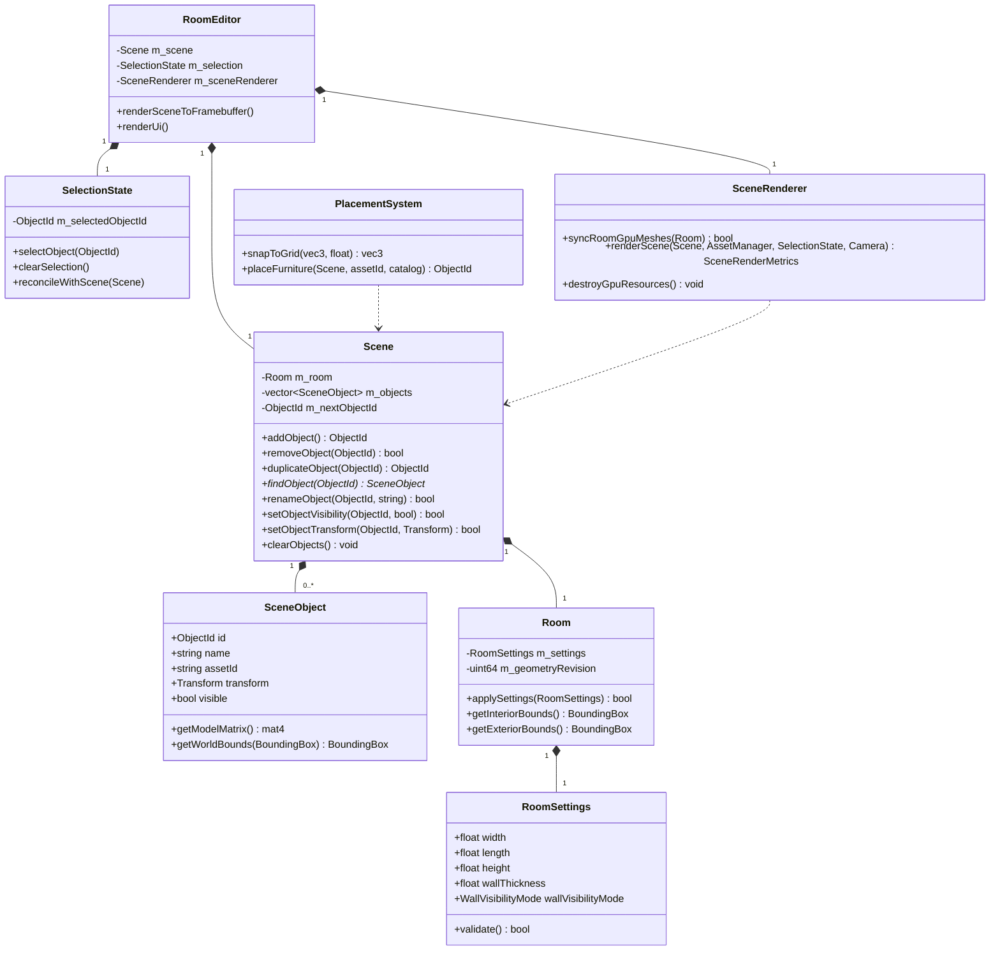
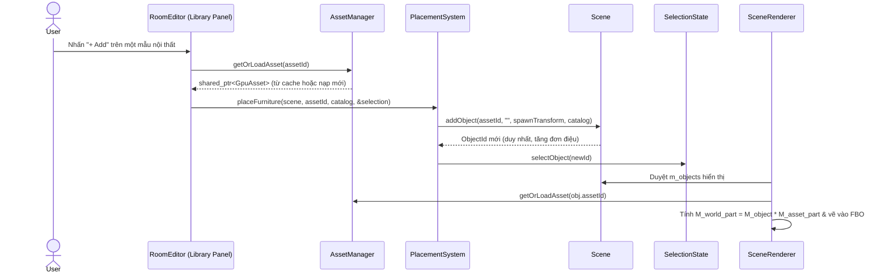
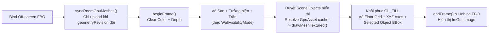

# Kiến trúc Quản lý Cảnh 3D — RoomCraft 3D (Scene Management)

Tài liệu này giải thích thiết kế và các thuật toán trong tầng **`roomcraft_scene`** (thuần CPU) và **`SceneRenderer`** (tầng GPU) được triển khai tại **Milestone M4**.

---

## 1. Phân biệt `Asset` và `SceneObject` (Shared GPU Resources)

Một quyết định kiến trúc cốt lõi của RoomCraft 3D là tách biệt **tài nguyên hình học dùng chung (`Asset`)** khỏi **thể hiện đặt trong phòng (`SceneObject`)**:

| Thuộc tính | `Asset` (`AssetData` / `GpuAsset`) | `SceneObject` (Instance trong `Scene`) |
|---|---|---|
| Định danh | `assetId` (vd: `blender-gaming-chair`) | `ObjectId` (`uint64_t` duy nhất, vd: `#1`, `#2`, `#3`) |
| Nơi quản lý | `AssetManager` (cache toàn cục) | `Scene::m_objects` |
| Dữ liệu lưu trữ | VAO, VBO, EBO, Material, Texture | Tên hiển thị, `assetId`, `Transform`, `visible`, `locked` |
| Chia sẻ | Nhiều `SceneObject` dùng chung 1 `GpuAsset` | Mỗi đối tượng biến đổi vị trí, xoay, tỷ lệ độc lập |

Nhờ tách biệt này, khi benchmark với **100 vật thể** dùng 6 loại nội thất, bộ nhớ GPU chỉ lưu **6 `GpuAsset` (7,121 đỉnh)** duy nhất thay vì sao chép 100 lần. Xóa một `SceneObject` không hủy `GpuAsset` của các vật thể còn lại, và khi `AssetManager::reloadAsset()` thay thế tài nguyên, `SceneRenderer` tự động lấy phiên bản mới nhất theo `assetId` mà không giữ con trỏ treo (dangling pointer).

---

## 2. Chiến lược Stable Object ID (`ObjectId`)

- `ObjectId` là kiểu số nguyên `uint64_t` (`0` = `kInvalidObjectId`).
- `Scene::m_nextObjectId` khởi đầu từ `1` và tăng đơn điệu sau mỗi lần `addObject()` hoặc `duplicateObject()`.
- **Không dùng chỉ mục `std::vector`** làm định danh: xóa một đối tượng ở giữa danh sách không làm thay đổi ID của các đối tượng còn lại.
- **Không tái sử dụng ID đã xóa** trong cùng phiên làm việc (kể cả sau `clearObjects()`), đảm bảo an toàn cho `SelectionState`, ImGui ID trong Hierarchy, Undo/Redo (M6) và JSON Serialization (M8).

---

## 3. Quy ước Hệ tọa độ Phòng & Sinh Hình học Phòng (`Room`)

- Hệ tọa độ tay phải (Right-handed), trục `+Y` hướng lên, đơn vị **mét (m)**, gốc `(0, 0, 0)` đặt tại **tâm mặt trên của sàn**.
- `width` ($W$, trục $X$) và `length` ($L$, trục $Z$) là **kích thước sử dụng bên trong phòng**:
  $$-\frac{W}{2} \le x \le \frac{W}{2}, \qquad 0 \le y \le H, \qquad -\frac{L}{2} \le z \le \frac{L}{2}$$
- **Sàn (`Floor`)**: Khối hộp $(W + 2t) \times t_{\text{floor}} \times (L + 2t)$ dịch xuống sao cho mặt trên nằm chính xác tại $y = 0$ và độ dày kéo xuống $y = -t_{\text{floor}}$.
- **4 Bức tường (`North`, `South`, `West`, `East`)**: Dựng **ra phía ngoài** giới hạn bên trong bằng `PrimitiveGenerator::createCuboid`:
  - Tường Bắc (`-Z`) & Tường Nam (`+Z`): rộng $W + 2t$, dày $t$, cao $H$ → phủ kín 4 góc tường.
  - Tường Tây (`-X`) & Tường Đông (`+X`): rộng $t$, dài $L$, cao $H$ → lắp khít giữa tường Bắc và Nam, **không có khe hở góc** và **không có mặt đồng phẳng gây z-fighting**.
- **Lưới sàn (`Grid`)**: Đặt tại $y = 0.002\text{ m}$ (lệch nhẹ 2 mm) tránh z-fighting với mặt trên sàn.
- **Transactional Rebuild**: `Room::applySettings()` kiểm tra hợp lệ toàn bộ tham số trước; nếu chỉ đổi màu hoặc chế độ ẩn/hiện tường (`WallVisibilityMode`), **không** tái sinh lưới CPU hay tăng `geometryRevision`.

---

## 4. Biến đổi phân cấp & World-Space BoundingBox

Mỗi `SceneObject` kết hợp ma trận gốc của nó với ma trận cục bộ của từng sub-mesh trong asset:

$$M_{\text{world\_part}} = M_{\text{object}} \cdot M_{\text{asset\_part}}$$

*(Với mô hình nhập từ Blender qua `ModelLoader`, ma trận node đã được nướng vào đỉnh một lần duy nhất nên $M_{\text{asset\_part}} = I$, tránh nhân hai lần).*

Hộp bao thế giới (World-space AABB) của đối tượng được tính bằng cách biến đổi cả **8 đỉnh góc** của `localBounds` qua $M_{\text{object}}$ rồi lấy `min`/`max` mới (`SceneObject::getWorldBounds()`), nhờ đó phản ánh chính xác kích thước bao bọc ngay cả khi đối tượng xoay góc bất kỳ.

---

## 5. Sơ đồ lớp (Class Diagram)

---

## 6. Sơ đồ tuần tự thêm nội thất (Sequence Diagram)

---

## 7. Luồng Render Cảnh 3D (`SceneRenderer`)

