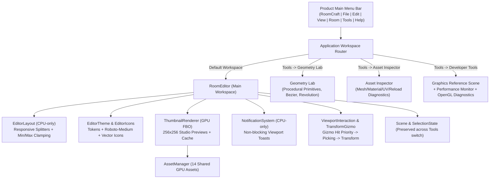

# Kiến trúc Giao diện Người dùng — RoomCraft 3D (UI Architecture — M6)

Tài liệu này mô tả kiến trúc giao diện chuyên nghiệp của **RoomCraft 3D** tại **Milestone M6 (`v0.6.0`)**: bố cục đa khung có thanh kéo đổi kích thước, hợp nhất thanh menu sản phẩm, hệ thống render ảnh thu nhỏ nội thất trên GPU, 3-Axis Move Gizmo và luồng định tuyến sự kiện không xung đột.

---

## 1. Sơ đồ Thành phần UI & Luồng Dữ liệu



### Nguyên tắc Tách tầng (Separation of Concerns)
- **Logic bố cục & thông báo thuần CPU (`roomcraft_scene`)**: [`EditorLayout`](../include/roomcraft/editor/EditorLayout.hpp), [`NotificationSystem`](../include/roomcraft/editor/NotificationSystem.hpp), [`TransformGizmo`](../include/roomcraft/systems/TransformGizmo.hpp) không phụ thuộc OpenGL hay Dear ImGui → kiểm thử tự động 100% qua `RoomCraft3D_EditorUiUnitTests`.
- **Trình bày & GPU (`roomcraft_engine`)**: [`EditorTheme`](../include/roomcraft/editor/EditorTheme.hpp), [`EditorIcons`](../include/roomcraft/editor/EditorIcons.hpp), [`ThumbnailRenderer`](../include/roomcraft/graphics/ThumbnailRenderer.hpp), [`RoomEditor`](../include/roomcraft/editor/RoomEditor.hpp), [`Application`](../include/roomcraft/core/Application.hpp).
- **Bảo toàn trạng thái phòng khi chuyển công cụ**: `Application::switchWorkspace()` lưu riêng `m_roomCameraState` trước khi chuyển sang `Geometry Lab`, `Asset Inspector` hoặc `Graphics Reference Scene`, và khôi phục nguyên trạng Camera, `Scene` lẫn `SelectionState` khi quay lại `Room Editor`.

---

## 2. Bố cục Không gian Làm việc Chính (`EditorLayout`)

```text
+---------------------------------------------------------------------------------+
| [Logo] RoomCraft   File  Edit  View  Room  Tools  Help          Modern Bedroom  | <- Main Menu Bar
+---------------------------------------------------------------------------------+
| [New] | [Sel][Move][Rot][Scale] | [Snap][Gizmo][Grid] | [3D][Top][Iso][Fit] |Pr.| <- Main Toolbar
+------------------+-------------------------------------------+------------------+
| FURNITURE LIBRARY|  [Perspective · 3D]       [Solid / Wire]  | SCENE HIERARCHY  |
| [Search...]      |                                           | v Modern Bedroom |
| [All][C++][OBJ]  |                                           |   Floor & Walls  |
| [All Categories] |             3D ROOM VIEWPORT              |   Modern Bed [E L]|
| +------+ +------+|            (Largest Region)               |  >Gaming Chair   |
| |[256px| |[256px||             + 3-Axis Gizmo                +----Splitter------+
| |Thumb]| |Thumb]||             + Cyan Selection              | PROPERTIES|ROOM  |
| +------+ +------+|                                           | Gaming Chair     |
| [+ Add Furniture]|  [Move · Gaming Chair]      [Toast Info]  | v Transform (X/Y/Z)
+------------------+-------------------------------------------+------------------+
| Room: 5.0 x 6.0 x 3.0 m | Objects: 7 | Grid: 0.50 m | Move      * Scene ready   | <- Status Bar
+---------------------------------------------------------------------------------+
```

### Thuật toán Chia khung Đáp ứng (`EditorLayout::compute()`)
- Khung hiển thị được chia sạch không chồng lấn cho mọi độ phân giải từ `1280×720` đến `1920×1080` và các mức UI Scale `100% / 125% / 150%`.
- **Ràng buộc an toàn**:
  - Chiều rộng Viewport tối thiểu `kMinCenterViewportWidth = 380 px` (tự động thu gọn 2 cột bên theo tỷ lệ khi cửa sổ nhỏ hoặc phóng đại UI).
  - Cột trái (`Furniture Library`) kẹp trong `[220, 420] px` (mặc định `272 px`).
  - Cột phải (`Hierarchy + Inspector`) kẹp trong `[260, 460] px` (mặc định `316 px`), chia dọc bởi thanh kéo ngang (`m_hierarchyRatio` trong `[0.25, 0.72]`, mặc định `0.36`).
- **Thanh kéo tương tác (Interactive Splitters)**: Người dùng kéo trực tiếp đường phân cách `5 px` (đã hạ `WindowMinSize` xuống `(1, 1)` để tuyệt đối không đè lên panel bên cạnh) giữa `Library | Viewport`, `Viewport | Right Panel` và `Hierarchy / Inspector` bằng chuột; có thể đặt lại mặc định qua `View -> Reset Workspace Layout`.

---

## 3. Hệ thống Ảnh thu nhỏ Nội thất (`ThumbnailRenderer`)

[`ThumbnailRenderer`](../include/roomcraft/graphics/ThumbnailRenderer.hpp) sinh ảnh xem trước **thật** trên GPU cho toàn bộ 14 mẫu nội thất (6 Procedural C++ + 8 Blender OBJ):

1. **Off-screen FBO độc lập (`256 × 256 px`)**: Sử dụng shader `mesh.vert` / `mesh.frag` hiện có và `GpuAsset` dùng chung từ `AssetManager` (không tạo bản sao mesh dư thừa).
2. **Góc nhìn Studio 3/4 tự động căn khung**: Dùng `Camera::fitBoundingBox(..., 1.32f)` trên nền studio trung tính `#2A303B` giúp hình khối và texture nội thất hiển thị rõ ràng, nổi bật ngay cả với các vật liệu tối màu.
3. **Cache thông minh & Invalidation**:
   - Cache theo khóa `assetId` kết hợp lưu `sourceAssetToken` (con trỏ `const assets::GpuAsset*`).
   - Sau lần render đầu tiên (~`3.70 ms` cho cả 14 mẫu), mọi khung hình sau chỉ đọc thẳng `GLuint` texture ID đã cache — **0 draw call phát sinh thêm mỗi khung hình**.
   - Khi người dùng bấm `Reload Asset` trong `Asset Inspector`, `m_thumbnailRenderer.invalidate(assetId)` (hoặc tự phát hiện đổi token) sẽ xóa bản cũ và render lại đúng một lần.
4. **Bảo toàn tuyệt đối trạng thái OpenGL**: Lưu và khôi phục `GL_DRAW_FRAMEBUFFER_BINDING`, `GL_VIEWPORT`, `GL_DEPTH_TEST`, `GL_POLYGON_MODE` và `GL_SCISSOR_TEST` trước/sau khi vẽ thumbnail để không bao giờ làm hỏng trạng thái render của Viewport chính hay Dear ImGui.

---

## 4. Tích hợp 3-Axis Move Gizmo (`TransformGizmo` + `SceneRenderer`)

- **Phạm vi triển khai tại M6**: **3-Axis Move Gizmo** (P1 — `M6-T21`) hỗ trợ kéo trực tiếp theo trục **X (Đỏ)**, **Y (Xanh lá)** hoặc **Z (Xanh dương)**. *(Rotate/Scale Gizmo là hạng mục tùy chọn P2 — `M6-T22`, giữ `TODO`.)*
- **Kích thước màn hình ổn định**: `TransformGizmo::computeHandleLength()` tự tỷ lệ hóa chiều dài trục theo khoảng cách từ Camera tới tâm đối tượng (Perspective) hoặc theo `orthoHalfHeight` (Orthographic), đảm bảo tay cầm luôn dễ bấm ở mọi mức zoom.
- **Độ ưu tiên Hit-Testing**:
  1. Trong `ViewportInteraction::processInput()`, khi đối tượng đang chọn hiển thị Move Gizmo, mỗi khung hình hover sẽ gọi `TransformGizmo::hitTestMoveAxis()` (tính khoảng cách gần nhất giữa tia chuột 3D và 3 đoạn thẳng trục X/Y/Z).
  2. Khi nhấn chuột trái trong chế độ `Select` hoặc `Move`, **tay cầm Gizmo luôn được ưu tiên hơn vật thể phía sau**.
  3. Nếu đối tượng đang `Locked`, hệ thống vẫn hiển thị gizmo ở màu trung tính nhưng **chặn kéo** và phát thông báo cảnh báo qua `NotificationSystem`.
  4. Nhấn **`Esc`** khi đang kéo tay cầm Gizmo sẽ khôi phục nguyên trạng `initialTransform` tương tự mọi thao tác biến đổi khác.

---

## 5. Luồng Định tuyến Đầu vào & Tránh Xung đột UI

- **Mouse/Keyboard Capture Guard**: Toàn bộ chuột/phím Viewport chỉ chạy khi con trỏ nằm trong hình ảnh FBO (`IsItemHovered`), không có popup/modal nào đang mở (`IsPopupOpen`) và không gõ chữ trong ô nhập liệu (`WantTextInput`).
- **Toast Notifications (`NotificationSystem`)**: Thông báo không chặn thao tác (tối đa 4 thông báo xếp chồng góc dưới-phải Viewport, tự biến mất sau `3.0 s`), tách biệt rõ 3 mức `Info`, `Success`, `Warning`.
- **Confirmation Modals**: Hành động phá hủy (`New Room`, chuyển `Room Preset` khi cảnh đang có chỉnh sửa, `Delete Object` từ nút bấm/menu) đều đi qua modal xác nhận rõ ràng trước khi thực thi.
